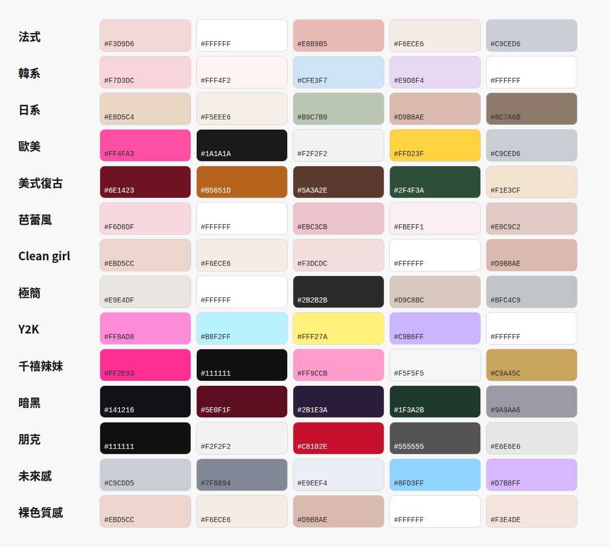

# Undertone 素材庫（後台）

2026-10-02 · @🔌

## 用法

這份是 Undertone 的後台資料，用來鎖定風格走向和各種元素的運用。從雙模式 v11 起，生成器會直接讀這份後台：Claude 會把這裡的內容整理成資料存進生成器，生成器推薦、讀參考圖、現場畫、用說的修改時都以這裡為依據；後台有更新時，Claude 要同步一次（更新日期寫在下方「生成器怎麼讀後台」）。

1. 看到喜歡的美甲，把圖貼到「參考圖索引」，給一個編號（R01、R02…）。
2. 填來源、風格、用到的元素、喜歡的點；不確定的欄位可以留空，留留言給 Claude 補。
3. Claude 會把參考圖歸納進「風格走向」和「元素運用」，並在那裡寫上參考圖編號。

## 待辦清單

生成器還沒做完的改動。每次改完會更新狀態；最近更新：2026-10-13（v27）。

| 編號 | 項目 | 狀態 |
|---|---|---|
| 1 | 客人明確選的優先：設計師「想收斂」不能把繁複程度降得比客人選的低，也不能拿掉客人加的元素 | 已完成（v13：拿掉的元素不會再被加回來；收斂只能動設計師自己加的，否則改成縮小；設計師加的會標出來） |
| 2 | 客人加的元素一定放上去，放不下要寫出來 | 已完成（v12；v13 起只保證客人自己選的元素；v15 補放改成一定放得上，不再靠機率） |
| 3 | 選「畫上去的圖案為主」時元素用平面手繪；自己寫元素時可選畫上去或立體 | 已完成（v13：自己寫元素可選畫上去、純透明、軟糖、凝膠、金屬） |
| 4 | 配色對比保護：太淡時補一個同色系深一階的重點色 | 已完成（v12，模式 A；v15 擴大到圖案線條、圖案色、平面元素） |
| 5 | 金屬顏色先看後台參考圖，再看配色冷暖 | 已完成（v12；v13 修正：後台寫「只用銀／金」直接照做，否則看哪個顏色提得多；v17 黑白風格一律用銀） |
| 6 | 淡色果凍邊緣看得出來、日系厚亮果凍 | 已完成（v12） |
| 7 | Clean girl、極簡、日系也照繁複程度決定有圖案的指甲數 | 已完成（v13：有圖案的指甲數照繁複程度 0 到 4 根） |
| 8 | 小元素設最小尺寸、成串拉開間距 | 已完成（v12 最小尺寸；v13 成串間距拉開） |
| 9 | 日系手繪圖案：細線漩渦、捲圈線、八角放射星、放射短線、單點、手繪星星 | 已完成（v12；v13 補上細格紋、水彩色帶） |
| 10 | 日系星星：平面手繪、低飽和 | 已完成（v12，手繪星星圖案） |
| 11 | 日系預設：短方圓、低飽和色票、每根不同、銀色 | 已完成（v12） |
| 12 | 水波紋拆成透明凝膠水波和金屬水波 | 已完成（v12 新增「透明水波」，原本的改名「金屬水波」；v15 透明水波重畫，不再像煎蛋；v17 金屬水波改成團聚的一灘，不再拉成長條） |
| 13 | 立體材質新增純透明、軟糖 | 已完成（v12） |
| 14 | 立體形狀修飾：圓角、有厚度 | 大致完成（v12 圓角胖星；v13 十字改圓角；其他元素之後看測試再修） |
| 15 | 液態金屬重做：流動潑濺、立體符號、細線線框 | 已完成（v12 流動潑濺；v13 新增「立體鉻飾」和「鉻線線框」） |
| 16 | 模式 A 新增色系題，色系優先於風格預設配色 | 已完成（v14：第 4 題，最多選兩個，可換一組或自己挑色） |
| 17 | 日系選豐富、極繁時還是太少 | 已完成（v15：主圖案放大，加小點綴，豐富每根 2 到 3 個、極繁 4 個） |
| 18 | 自己寫的元素和手繪圖案很像時不要疊在同一根 | 已完成（v15：分開放，加入時先問要用現有圖案還是畫新的） |
| 19 | 客人選了色系時，設計師「想玩色」不能加撞色 | 已完成（v15：改成在客人的色系裡換深淺） |
| 20 | 「配色 3 色內」把跳色刪掉，整組太無聊 | 已完成（v16：改成底色＋主色＋跳色，跳色只用在 2 根的圖案或點綴） |
| 21 | 細線漩渦、捲圈線太細 | 已完成（v16：線寬隨繁複程度加粗，有粗細起伏） |
| 22 | 模式 B 讀圖、現場畫、用說的修改沒有真的讀到後台 | 已完成（v17：附上特殊風格規則、R01～R08、液態金屬做法、常見搭配、不搭的組合，並在第 3 步和紀錄寫出送了哪些段落） |
| 23 | 設計師加元素要有依據 | 已完成（v17：照後台「常見搭配」推，找不到就不加，說明寫出依據） |
| 24 | 黑白鉻參考圖（R07、R08）的做法 | 已完成（v17：新增鋼珠元素和格線＋鋼珠、留白四芒星、黑白色塊、整片鉻銀＋一排鋼珠四種底色） |
| 25 | 試戴：只要是手都偵測得到、都戴得上 | 已完成（v26：最多兩隻手，左右手、手心手背都戴） |
| 26 | 不懂美甲、想要酷帥黑色金屬的客人，被問題導到可愛方向 | 已完成（v26：新增「黑金屬」風格；第 2 題改成「想要什麼氣質」並加「酷帥俐落」；感覺加「酷酷的、帥帥的、金屬感的」；提示詞不再預設客人是女生） |
| 27 | 黑金屬的參考圖 | 已完成（v27：R29～R34，黑金屬依參考重寫） |
| 28 | 元素運用表 | 初稿已補（v26，依一般美甲做法整理），待參考圖逐一確認 |
| 29 | 方圓、橢圓甲型 | 已完成（v27：生成器新增方圓、橢圓；黑金屬預設短方圓） |
| 30 | 「金屬」和「鏡面」質感 | 已完成（v27：合併成「金屬鏡面」） |

## 風格走向

風格分成三類：地區流派、風格氛圍、質感材質。一組指甲通常是「一個流派或氛圍＋一種質感」，例如韓系＋水光、暗黑＋鏡面，所以三類可以互相疊加。v23 起每個風格的配色、甲型、底紋和元素都依參考圖（R17～R28）重寫；v26 新增「黑金屬」，v27 依 R29～R34 重寫；v27 起「金屬」和「鏡面」合併成「金屬鏡面」。

| 類型 | 風格 | 配色 | 甲型 | 材質 | 繁簡與常見元素 | 參考圖 |
|---|---|---|---|---|---|---|
| 地區流派 | 法式 French | 透明或淡粉底＋白甲尖；也有細線法式、彩色或雙色甲尖、亮片甲尖、V 字甲尖、描邊法式 | 杏仁、短方圓 | 亮面、透明感 | 極簡～簡約；甲尖可加珍珠或一小顆水鑽 | R17、[Pinterest](https://www.pinterest.com/search/pins/?q=french%20manicure%20nails) |
| 地區流派 | 韓系 | 透明果凍疊色、裸底配中間粉色暈染、柔和同色系 | 短圓 | 糖漿果凍、刷紋水波、透明凝膠水滴；「質感就是設計」 | 每根做法不同；同色系立體小飾品（愛心、蝴蝶結、小花、水滴）、透明泡泡 | R18、[Pinterest](https://www.pinterest.com/search/pins/?q=korean%20nail%20art) |
| 地區流派 | 日系 | 低飽和：灰薰衣草、奶油、灰藍、灰粉、深梅紫 | 短圓、短方圓 | 厚亮果凍，每根不同的果凍底 | 每根一個簡單平面手繪（小星星、波點、八芒星、細線漩渦、捲圈線、細格紋…），大量留白；立體只有小圓珠和凝膠水波 | R01、R28、[Pinterest](https://www.pinterest.com/search/pins/?q=japanese%20nail%20art) |
| 地區流派 | 歐美 | 奢華粉、霓虹、黑白，配鏡面鉻 | 超長棺材、尖錐 | 高亮面、鏡面鉻、甜甜圈光 | 越多越好：水鑽必放，大寶石、珍珠、吊飾、鍊條、立體蝴蝶；變化法式、漸層、動物紋 | R22、[Pinterest](https://www.pinterest.com/search/pins/?q=baddie%20acrylic%20nails) |
| 地區流派 | 美式復古 | 櫻桃紅、玳瑁棕、寶石色（祖母綠、寶藍、酒紅）、奶油 | 中杏仁 | 亮面、絲絨霧面、珍珠光 | 櫻桃必放；玳瑁、白波點、黑金甲根半月；金色小配件 | R23、[Pinterest](https://www.pinterest.com/search/pins/?q=vintage%20retro%20nails) |
| 風格氛圍 | 芭蕾風 Balletcore | 淡粉、裸粉、奶白，薄透 | 中棺材（芭蕾形） | 薄透亮面、珍珠光 | 簡約；蝴蝶結必放、中間一顆珍珠，只放一兩根；交叉緞帶法式、手繪蕾絲 | R19、[Pinterest](https://www.pinterest.com/search/pins/?q=balletcore%20nails) |
| 風格氛圍 | Clean girl | 接近膚色的透明裸色；冷膚配裸粉、暖膚配偏棕或偏橘 | 短圓 | 薄透＋高光澤，光澤就是重點 | 不放裝飾 | R20、[Pinterest](https://www.pinterest.com/search/pins/?q=clean%20girl%20nails) |
| 風格氛圍 | 極簡 Minimal | 透明裸底配黑、金或單一色 | 短方 | 亮面或霧面 | 大量留白，只有一兩根有細節：細直線、甲根月牙、三個小點、描邊法式、半邊色塊、金色小星月 | R21、[Pinterest](https://www.pinterest.com/search/pins/?q=minimalist%20nail%20art) |
| 風格氛圍 | Y2K | 兩個方向：辣妹動物紋（熱粉、白、黑、裸配銀）、粉嫩 <333（薄荷、粉） | 辣妹：超長尖錐；粉嫩：中杏仁 | 亮片、鏡面、果凍、有色凝膠 | 辣妹：斑馬紋、豹紋、法式水鑽線、鑽面銀星；粉嫩：哥德十字、泡泡字 <3、條紋法式 | R09～R11、R27、[Pinterest](https://www.pinterest.com/search/pins/?q=y2k%20nails) |
| 風格氛圍 | ~~千禧辣妹~~ | 2026-10-11 併入 Y2K 的「辣妹動物紋」 | — | — | — | R27 |
| 風格氛圍 | 暗黑 Goth | 黑、酒紅、深紫、墨藍、炭灰 | 長尖錐 | 絲絨霧面和鏡面交替、深紫貓眼 | 適中：黑色蕾絲、深色法式、金色碎片、深色水鑽、鉚釘；銀和錫色點綴 | R24、[Pinterest](https://www.pinterest.com/search/pins/?q=goth%20nails) |
| 風格氛圍 | 朋克 Punk | 黑白紅、螢光粉配黑 | 中方 | 霧面配金屬 | 黑白格、條紋、格紋、閃電；鉚釘排成一列（必放）、鍊條、安全別針 | R25、[Pinterest](https://www.pinterest.com/search/pins/?q=punk%20nails%20studs) |
| 風格氛圍 | 黑金屬（酷帥） | 裸色果凍、黑亮面、煙燻棕黑暈染，配銀；只用銀 | 短方圓、短圓 | 黑亮面、裸色果凍、熔融鉻、液態金屬 | 每根一個銀色主結構：金屬花十字、鉻網泡泡（透明凝膠圓頂＋液態銀網）、熔融鉻、立體鉻飾（漩渦、三葉、花生形團塊）、荊棘鉻線；點綴錐形尖刺、鍊條、鋼珠、黑色部落紋；不放甜美元素。中性、男生也適合 | R29～R34；做法也參考 R03～R08 |
| 風格氛圍 | 未來感 Futuristic | 銀、鉻光暈、混搭金屬 | 長杏仁 | 鏡面鉻、貓眼光暈 | 立體鉻飾必放、金屬滴落、鋼珠 | R26、[Pinterest](https://www.pinterest.com/search/pins/?q=futuristic%20chrome%203d%20nails) |
| 質感材質 | 裸色 Nude | 貼近膚色的米、粉、棕 | 短～中 | 亮面或霧面 | 極簡 | [Pinterest](https://www.pinterest.com/search/pins/?q=nude%20nails) |
| 質感材質 | 奶油肌 Milky | 奶白、奶粉、奶米 | 短甲最適合 | 介於不透明與半透明的雲霧感，不靠鉻粉 | 極簡；可做奶白法式 | [Pinterest](https://www.pinterest.com/search/pins/?q=milky%20nails) |
| 質感材質 | 透明感 Jelly | 有顏色但透光，像果凍軟糖 | 不限 | 低遮蓋、高光澤；糖漿 syrup 是更透的版本 | 簡約 | [Pinterest](https://www.pinterest.com/search/pins/?q=jelly%20nails) |
| 質感材質 | 玻璃感 Glass | 無色或奶色底 | 不限 | 生成器目前的做法：透明底加細緻的反光，重點是光而不是顏色（待確認：要不要改成韓系有折射碎片的玻璃甲） | 簡約 | [Pinterest](https://www.pinterest.com/search/pins/?q=korean%20glass%20nails) |
| 質感材質 | 水光 Glazed | 裸色或奶色底＋珍珠白鉻粉 | 短～中 | 柔和珍珠光，不是鏡面反射 | 極簡 | [Pinterest](https://www.pinterest.com/search/pins/?q=glazed%20donut%20nails) |
| 質感材質 | 珍珠 Pearl | 奶白、淡粉、粉彩 | 不限 | 珍珠光澤底（比水光更柔、像緞面）＋立體珍珠 | 簡約～繁複：單顆點綴、散落、法式鑲邊、配金鍊 | [Pinterest](https://www.pinterest.com/search/pins/?q=pearl%20nails) |
| 質感材質 | 金屬鏡面 Chrome | 銀、金、玫瑰金，或疊在深色上 | 不限；黑金屬用短方圓 | 鏡面金屬鉻粉，高反射（v27 由「金屬」「鏡面」合併） | 簡約～適中；鉻法式、金屬立體飾 | [Pinterest](https://www.pinterest.com/search/pins/?q=chrome%20nails) |

## 元素運用

每個元素收集它在真實美甲上的不同做法（大小、立體型態、擺放位置、和什麼搭），這是解決「同一個元素永遠長一樣」的依據。v26 先依一般美甲做法補上初稿，標「初稿」的之後用參考圖確認。

| 元素 | 看到的做法 | 常搭配 | 參考圖 |
|---|---|---|---|
| 玫瑰 | 初稿：立體凝膠雕花玫瑰（同色系最常見）、平面手繪小玫瑰、浮雕線稿玫瑰；多半放無名指甲面中央或甲根一側 | 珍珠、金箔、法式、絲絨底；芭蕾風、美式復古 | [Pinterest](https://www.pinterest.com/search/pins/?q=3d%20rose%20nails) |
| 雕花 | 初稿：同色立體浮雕（白底白花、裸底裸花），像蕾絲或石膏雕刻；整片或只在甲根 | 奶油肌、珍珠光底；小珍珠 | [Pinterest](https://www.pinterest.com/search/pins/?q=3d%20carved%20flower%20nails) |
| 蝴蝶結 | 初稿：立體凝膠或金屬吊飾、緞帶線畫的平面蝴蝶結、迷你蝴蝶結點在甲根；芭蕾風中間放一顆珍珠 | 珍珠、交叉緞帶法式、淡粉薄透底 | R19、[Pinterest](https://www.pinterest.com/search/pins/?q=bow%20nails) |
| 珍珠 | 初稿：單顆點在甲根或甲尖、排成一列沿法式線、散落大小不一、半顆珍珠嵌在甲面 | 金鍊、蝴蝶結、法式、奶油肌、水光 | [Pinterest](https://www.pinterest.com/search/pins/?q=pearl%20nail%20charms) |
| 水鑽／大寶石 | 初稿：法式微笑線鑲一排小鑽、甲根一排、滿鑽鋪面、一顆大寶石當主角配小鑽圍邊 | 鏡面鉻、粉白漸層、水滴形吊飾；歐美、Y2K 辣妹 | R09、R22、[Pinterest](https://www.pinterest.com/search/pins/?q=rhinestone%20gem%20nails) |
| 液態金屬 | 細線線框（部落紋、荊棘、愛心框）、甲緣外框、細胞網、立體符號（胖星、四芒星、漩渦、火焰）、整片厚塑熔融、鉻邊透明凝膠、泡泡卵石堆疊、流動潑濺、鑲嵌框；詳見「液態金屬做法」 | 鋼珠（單顆或 2 到 3 顆一組）、極光透明底、純透明凝膠、奶白底、煙燻透明、霧黑底、藍墨暈染、貝殼片 | R03～R08、[Pinterest](https://www.pinterest.com/search/pins/?q=liquid%20metal%20drip%20nails) |
| 鍊條 | 初稿：細金屬鍊貼在甲根弧線或法式線、斜跨甲面、垂在甲尖當吊飾；粗鍊少見 | 鉚釘、珍珠、霧黑底、黑白格；朋克、歐美、黑金屬 | R10、R25、[Pinterest](https://www.pinterest.com/search/pins/?q=chain%20nail%20charms) |
| 鉚釘 | 初稿：小金屬尖點排成一列（像莫西干頭），或沿甲緣一圈；不要太靠近甲根 | 霧黑或黑白格底、鍊條、安全別針 | R25、[Pinterest](https://www.pinterest.com/search/pins/?q=stud%20nails) |
| 鋼珠 | 鉻銀小圓球：單顆、排成一列、三顆一組；放在格線交叉點、四芒星旁、鉻線末端 | 黑白格線、整片鉻銀、鉻線框 | R07、R08 |
| 十字 | 初稿：細線十字（暗黑）、花邊哥德十字（Y2K 粉嫩，有色凝膠）、金屬十字吊飾 | 深色底、蕾絲、鋼珠描邊 | R11、R24 |
| 葉子 | 初稿：手繪細線葉、立體凝膠葉、金箔葉；常沿甲緣或斜放 | 小雛菊、大地色、奶油霧面 | [Pinterest](https://www.pinterest.com/search/pins/?q=3d%20leaf%20nail%20art) |
| 蝴蝶 | 初稿：手繪蝴蝶、透明凝膠翅膀、金屬吊飾；放斜對角有動態感 | 亮片、漸層、Y2K、歐美 | [Pinterest](https://www.pinterest.com/search/pins/?q=butterfly%20nails) |
| 櫻桃 | 初稿：平面手繪兩顆一對、立體凝膠櫻桃；多配白或裸底 | 白波點、玳瑁、櫻桃紅亮面；美式復古 | R23、[Pinterest](https://www.pinterest.com/search/pins/?q=cherry%20nails) |
| 星星 | 平面手繪小星（日系）、鑽面銀鉻大星配小星（Y2K）、立體圓角胖星（液態金屬）、黑底留白四芒星（黑白鉻）、金色小星貼 | 依風格：日系配波點細線；Y2K 配水鑽；黑金屬配鋼珠 | R01、R06、R07、R09、R28 |
| 金屬花十字 | 哥德花十字的銀飾（四個末端分岔成花瓣），中間一顆鋼珠；放在黑亮面或熔融鉻框裡 | 錐形尖刺、鍊條、黑色部落紋 | R31、R32、R34 |
| 錐形尖刺 | 銀色圓錐，像穿環一樣一左一右夾住圖案，或單顆斜插在甲緣 | 黑色部落紋、生化符號、金屬花十字 | R32、R34 |
| 鉻網泡泡 | 一顆大的透明凝膠圓頂配幾顆小的，外圈和縫隙是液態銀，圓頂帶極光（綠粉）反光；也有黑色手繪版（細胞網＋一顆灰色凝膠圓頂） | 裸色果凍底、極光、鋼珠 | R29、R30 |
| 手繪圖案 | 日系細線手繪（漩渦、捲圈線、八芒星、放射短線）、蕾絲（暗黑、芭蕾）、閃電（朋克）；線條粗細有起伏 | 果凍底、留白 | R01、R24、R25、R28 |

## 液態金屬做法

從 R03～R06 歸納。液態金屬幾乎都是銀色；底色以透明、極光透明、奶白、煙燻透明為主，讓金屬的反光成為主角。

| 類型 | 長相 | 常見底 | 常見甲型 | 參考圖 |
|---|---|---|---|---|
| 細線線框 | 細細的鉻線勾出部落紋、荊棘或愛心輪廓，線的末端收尖、帶小刺，常左右對稱，中間點一顆鋼珠 | 極光透明（灰藍底帶橘粉反光） | 長尖錐、長杏仁 | R03 |
| 甲緣外框 | 沿著指甲邊緣描一圈鉻線，往內長出分岔或尖刺，中間留透明 | 純透明、極光透明 | 長杏仁、尖錐 | R03、R06 |
| 細胞網 | 鉻線圍成大小不一的圓圈，連成網狀或泡泡 | 奶白、透明 | 杏仁 | R03、R05、R06 |
| 立體符號 | 單一個胖胖的鉻飾放在中間：圓角星、四芒星、漩渦、火焰、彎曲線條；邊緣圓潤、有厚度 | 純透明凝膠 | 杏仁 | R06、R05 |
| 整片厚塑熔融 | 厚厚一層金屬幾乎蓋滿甲面，表面有一圈圈像水紋的起伏皺褶，反光很強 | 金屬本身 | 短圓 | R04 |
| 鉻邊透明凝膠 | 一塊塊透明凝膠，邊緣和裂縫用鉻線勾出，像碎玻璃或冰塊 | 透明、膚色透 | 短圓 | R04 |
| 泡泡卵石堆疊 | 煙燻灰的透明圓頂一顆顆擠在一起，像卵石或泡泡 | 煙燻透明 | 短圓 | R04 |
| 流動潑濺 | 金屬像潑出來或融化攤開，輪廓不規則、粗細起伏，旁邊有小水珠 | 奶白、透明 | 杏仁 | R05 |
| 鑲嵌框 | 有機形狀的鉻框包住貝殼片或寶石 | 奶白 | 杏仁 | R05 |
| 點綴 | 鋼珠單顆或 2 到 3 顆一組；放射細線配中心鉚珠；藍墨暈染上散鉚珠 | 各種 | 各種 | R03、R04、R05 |

### 黑底的金屬做法（黑金屬風格用，v26）

從 R04、R07、R08、R29～R34 和上表歸納；男生或想要中性、俐落的客人優先用這幾種，甲型以短方圓、短圓為主。

| 做法 | 長相 | 底 | 參考 |
|---|---|---|---|
| 霧黑＋立體鉻飾 | 霧黑絨面底，中間一個胖胖的銀色立體符號（四芒星、漩渦、火焰），旁邊一兩顆鋼珠 | 霧黑絨面 | R06 的符號換成黑底 |
| 黑鏡面＋鉻線部落紋 | 黑色亮面底，細鉻線勾出對稱部落紋或荊棘，末端收尖 | 黑鏡面 | R03 的線框換成黑底 |
| 整片鉻銀＋一排鋼珠 | 整片銀色鏡面，甲根或中線一排鋼珠 | 鉻銀 | R07 |
| 黑底留白四芒星 | 黑底挖出一顆白色四芒星（負空間），旁邊配鋼珠 | 黑 | R07 |
| 煙燻黑透明＋鋼珠 | 煙燻灰黑的透明底，單顆鋼珠或卵石泡泡 | 煙燻透明 | R04 |
| 黑白格線＋鋼珠 | 白底黑細格線、交叉點放鋼珠；和黑底那幾根交替 | 白 | R07 |
| 深色法式＋銀線 | 裸或霧黑底，黑色甲尖，交界描一條細鉻線 | 裸、霧黑 | R24 |
| 熔融鉻整片 | 整片凹凸的液態銀，像錘打過的金屬 | 金屬本身 | R31 |
| 暈染底＋荊棘鉻線 | 棕黑或酒紅暈染（中間透、邊緣深），上面細鉻線勾出荊棘、肋骨或枝條 | 暈染 | R31、R33 |
| 立體鉻團塊 | 圓胖的三葉、花生形鉻團，像熔化的銀滴 | 棕黑透明 | R31 |
| 熔融鉻框＋黑面 | 液態銀厚框包住黑亮面，中間放金屬花十字 | 黑亮面 | R32、R34 |
| 銀箔碎片 | 皺皺的銀箔碎片散在暈染底上，配鋼珠 | 酒紅暈染 | R33 |

- 示意圖 A（小灘點綴）接近「流動潑濺」的小尺寸；B（流動大片）就是「流動潑濺」；C（水紋圈）的立體版就是「整片厚塑熔融」。
- 立體也不一定是金屬：同樣的形狀可以做成純透明凝膠或有顏色的軟糖質感（R02、R04 的透明凝膠）。

### 液態水波與透明凝膠泡泡（各風格通用，v27）

R02、R12、R14、R29、R30 都有「透明凝膠做出的水感」：透明或極光的圓頂、攤開的凝膠水窪、外圈用液態銀或黑線框起來。這不是黑金屬專屬，其他風格讀到相似的參考圖、或客人選了「透明的、黏黏的、金屬感的」時都可以用。

| 做法 | 長相 | 生成器的元素 | 適合 |
|---|---|---|---|
| 透明水波 | 厚的透明凝膠攤開成水窪，旁邊配小水珠 | 透明水波 | 日系、韓系、未來感 |
| 泡泡 | 小顆透明圓頂，單顆或散落 | 泡泡 | 韓系、Clean girl |
| 鉻網泡泡 | 透明圓頂一顆顆擠在一起，外圈和縫隙是液態銀，帶極光 | 鉻網泡泡 | 黑金屬、未來感、日系水波紋 |
| 黑線細胞網 | 手繪黑色細胞網，網眼裡放一顆灰色凝膠圓頂 | 手繪細胞網（底紋）＋泡泡 | 黑金屬、暗黑 |

## 排版排法

一手五根怎麼分配設計。A、B、C 代表不同的設計，順序是拇指→食指→中指→無名指→小指。常規是 3+2 穿插，其他排法是初步整理，之後用參考圖確認。這張表目前是給 Claude 推薦時參考；生成器實際的排法由「每根不同」和「裝飾最多的那根」決定，還沒有逐一對應這張表。

| 排法 | 五指 | 說明 | 適合的風格 |
|---|---|---|---|
| 3+2 穿插（常規） | A B A B A | 兩種設計交錯，最平均 | 大多數風格；黑金屬（霧黑和鏡面交替） |
| 3+2 集中 | A A A B B | 設計集中在無名指和小指，重心偏外側 | 韓系、Y2K |
| 4+1 重點指 | A A A B A | 只有無名指不同，最低調 | Clean girl、極簡、法式 |
| 雙重點指 | A A B B A | 中指和無名指一組 | 歐美、Y2K 辣妹 |
| 3+1+1 | A A B C A | 一個主設計，加兩根不同的重點 | 芭蕾風、日系 |
| 拇指主角 | B A A A A | 拇指面積最大，放最大的飾品 | 歐美 |
| 全手統一 | A A A A A | 五根同設計，靠質感和細節取勝 | 日系、美式復古、未來感 |
| 每根不同 | A B C D E | 五根各不相同，用配色串起來 | 韓系、日系、Y2K、朋克、黑金屬 |
| 漸層排列 | 1 2 3 4 5 | 顏色、密度或甲尖寬度逐根變化 | 法式、透明感 |
| 跨指連續 | 一張圖分五段 | 一個圖案橫跨五根，併攏才看得完整 | 暗黑、未來感 |

## 問題怎麼影響風格

生成器每一題的回答，最後怎麼影響推薦的風格和成品。系統會替 14 個風格打分數，分數最高的就是推薦風格；客人到「提案」頁還可以自己改。有 Claude 時由 Claude 推薦，這張表是沒有 Claude 時的規則，也會一起送給 Claude 參考。

| 題目 | 選項 | 對風格推薦的影響 | 對成品的其他影響 |
|---|---|---|---|
| 照片（第一步） | 今天的穿搭（可以用鏡頭拍）、風格參考圖，或不給 | 照片解析出的風格：風格參考圖加 4 分、穿搭照加 2 分；照片超出風格清單時，改走特殊風格 | 風格參考圖的配色全部照圖；穿搭照取 3 色，另外 2 色保留風格色；照片裡的元素優先放進去 |
| 今天的心情是？ | 開心、平靜、想舒壓、期待、焦躁、疲憊、低落、無感、想鬧一下 | 風格有對應這個心情加 1.5 分 | 心情的元素可以補進風格外的 1 個名額（選「酷帥俐落」時不補）；也影響手繪圖案 |
| 有多強烈？ | 1 到 5 | 不影響 | 飾品密度（佔 30%，熱鬧程度佔 70%） |
| 想要什麼氣質？ | 主流好看、日常可愛、低調耐看、酷帥俐落、有點怪、越華麗越好 | 風格有對應這個氣質加 3 分，是影響最大的一題 | — |
| 想要什麼樣的觸感？（複選） | 18 種，見下方「客人用語對照」 | 每個符合的感覺加 2 分 | 質感每個符合加 2 分；元素補 1 個；甲面圖樣加 1 種 |
| 今天想穿什麼顏色？ | 色系最多選兩組，或自己挑色 | 不影響 | 決定配色 |
| 要多熱鬧？ | 極簡、簡約、適中、豐富、極繁 | 極簡：Clean girl、極簡、法式加 2.5 分。極繁：Y2K、歐美加 1.5 分 | 元素數量 1、2、3、4、6 個；有圖案的指甲根數 |
| 還有什麼想讓設計師知道？ | 自由填寫 | 規則推薦不影響；Claude 推薦時會讀 | 出現特定關鍵字會加甲面圖樣，見下方「心情、氣質與場合」 |

分數比重整理：氣質（3 分）＞每個感覺（2 分）＞心情（1.5 分）。照片是例外，風格參考圖的 4 分會壓過其他題目。

v26 的變化：原本的「比較喜歡哪一種（飾品或圖案）」不再問，預設「兩種都要」，可以在提案頁的細節裡改。「方向」改名「氣質」並加上「酷帥俐落」，避免想走酷帥路線的客人被導到可愛的風格。模式 B「我有想要的」不問心情，第一步給圖或寫元素，再選「忠於原圖」或「套用風格」和熱鬧程度。

## 客人用語對照

客人選的「感覺」怎麼被翻成設計。這張表記錄生成器目前的對應，之後用參考圖和測試回饋修正。

| 客人說 | 設計上的意思 | 質感 | 甲面圖樣 | 元素 | 對應風格 |
|---|---|---|---|---|---|
| 軟軟的 | 低對比、圓潤、柔焦 | 奶油肌、珍珠 | 果凍、暈染 | 玫瑰、蝴蝶結、雲朵、愛心、雕花 | 韓系、芭蕾風 |
| 閃閃的 | 點狀反光 | 水光、珍珠 | 亮片、碎鑽 | 水鑽、大寶石、閃光星、珍珠 | 韓系、歐美、Y2K |
| 亮亮的 | 大面積反光 | 金屬鏡面 | 鏡面、極光 | 水鑽、大寶石、液態水波 | 歐美、Y2K、未來感 |
| 冷冷的 | 冷色、金屬、硬邊 | 金屬鏡面 | 鏡面、磁石 | 液態水波、金屬滴落、鍊條、十字 | 朋克、黑金屬、未來感 |
| 酷酷的 | 深色、俐落、不甜 | 金屬鏡面 | 絨面、鏡面 | 立體鉻飾、鉚釘、鍊條、十字 | 暗黑、朋克、黑金屬 |
| 帥帥的 | 霧黑或單色、線條乾淨、中性 | 金屬鏡面 | 素色、絨面 | 鉻線線框、鋼珠、鉚釘 | 黑金屬 |
| 金屬感的 | 銀色液態金屬當主角 | 金屬鏡面 | 鏡面、整片鉻銀 | 立體鉻飾、鉻線線框、金屬滴落、金屬水波、鋼珠 | 黑金屬、未來感 |
| 透明的 | 透光、低遮蓋 | 透明感、玻璃感 | 果凍 | 泡泡、珍珠、漩渦線 | 法式、韓系、Clean girl |
| 霧霧的 | 霧面、低光澤 | 奶油肌 | 奶油霧面、暈染、奶白半透 | 雕花、雲朵、珍珠 | 法式、日系、美式復古、極簡 |
| 乾乾淨淨的 | 留白、少元素 | 裸色、水光 | 法式、素色 | 珍珠、水鑽 | 法式、日系、芭蕾風、Clean girl、極簡 |
| 自然的 | 大地色、植物 | — | 漸層、奶油霧面 | 葉子、雛菊、蝴蝶、五瓣花 | 日系 |
| 甜甜的 | 高明度粉色、糖果感 | 透明感 | 波點、果凍 | 櫻桃、愛心、蝴蝶結、玫瑰 | 韓系、芭蕾風、Y2K |
| 圓圓的 | 圓點、球體 | — | 波點 | 珍珠、泡泡、愛心 | — |
| 刺刺的 | 尖角、銳利線條 | — | 斜條紋 | 十字、星星、鍊條、閃光星 | 歐美、暗黑、朋克、黑金屬 |
| 暗暗的 | 低明度、深色 | 鏡面 | 絨面、磁石、煙燻暈染 | 十字、月亮、金屬滴落、鍊條 | 美式復古、暗黑、黑金屬 |
| 毛毛的 | 絨面、柔軟材質 | — | 絨面 | 雲朵、蝴蝶結、雕花 | 美式復古、暗黑 |
| 亂亂的 | 不規則、元素多 | — | 格紋、故障條 | 櫻桃、蝴蝶、星星、金屬滴落 | Y2K、朋克 |
| 黏黏的 | 流動、液態 | 透明感、玻璃感 | 果凍、大理石 | 金屬滴落、泡泡、液態水波 | 未來感 |

「圓圓的」目前沒有對應的風格，只影響元素和圖樣。

## 心情、氣質與場合

生成器第二步的回答怎麼影響推薦。以下同樣是生成器目前的對應。

| 心情 | 對應風格 | 甲面圖樣 | 元素 |
|---|---|---|---|
| 開心 | 韓系、歐美、芭蕾風、Y2K | 波點、果凍 | 愛心、玫瑰 |
| 期待 | 韓系、歐美、芭蕾風、Y2K、黑金屬、未來感 | 亮片、鏡面 | 閃光星、水鑽 |
| 想鬧一下 | 歐美、Y2K、朋克 | 笑臉、格紋、草寫字 | 櫻桃、蝴蝶結 |
| 平靜 | 法式、韓系、日系、美式復古、芭蕾風、Clean girl、極簡、黑金屬 | 果凍、法式 | 珍珠、漩渦線 |
| 想舒壓 | 日系 | 果凍、漸層 | 雕花、雲朵 |
| 疲憊 | 日系、Clean girl | 果凍、大理石 | 珍珠、泡泡 |
| 無感 | 法式、美式復古、Clean girl、極簡、黑金屬 | 素色、格紋 | 水鑽 |
| 低落 | 美式復古、暗黑、黑金屬、未來感 | 大理石、貓眼 | 金屬滴落、星星 |
| 焦躁 | 暗黑、朋克、黑金屬、未來感 | 斜條紋、故障條 | 液態水波、鍊條 |

| 想要的氣質 | 對應風格 |
|---|---|
| 主流好看 | 法式、韓系、日系、歐美、芭蕾風、未來感 |
| 日常可愛 | 韓系、芭蕾風、Y2K |
| 低調耐看 | 法式、日系、美式復古、芭蕾風、Clean girl、極簡、黑金屬 |
| 酷帥俐落 | 暗黑、朋克、黑金屬、未來感 |
| 越華麗越好 | 歐美、Y2K、暗黑、未來感 |
| 有點怪 | 美式復古、Y2K、暗黑、朋克、黑金屬、未來感 |

注意：生成器目前沒有問「要做的事」，下面這張場合規則還留在程式裡，但不會觸發。

| 場合 | 建議長度 |
|---|---|
| 上班、在家 | 短 |
| 上課、出去玩 | 中 |
| 約會、朋友聚會、重要場合 | 長 |

| 「想說的話」裡出現 | 會加的圖樣 |
|---|---|
| 面試、報告、上班、開會、簡報 | 法式 |
| 約會、喜歡、見面 | 果凍 |
| 生日、派對、演唱會、慶祝、聚會 | 亮片 |
| 考試、死線、趕 | 故障條 |
| 睡、累、懶 | 漸層 |
| 下雨 | 波點 |
| 好笑、廢、爛、崩潰 | 笑臉 |

## 甲型與長度

生成器有方、方圓、圓、橢圓、杏仁、棺材、尖錐七種（v27 加入方圓和橢圓）。下表的「預設風格」照生成器 v27 的設定。

| 甲型 | 特徵 | 適合 | 生成器預設的風格 |
|---|---|---|---|
| 方 | 平直甲尖，俐落 | 短甲、手指修長；中性、男生常用 | 極簡、朋克 |
| 方圓 | 方形修掉尖角，耐用 | 日常、上班；中性、男生 | 黑金屬 |
| 圓 | 跟甲床弧度一致，最不易斷 | 短甲、自然甲 | 韓系、日系、Clean girl |
| 橢圓 | 拉長手指比例 | 短到中長 | 還沒有風格預設；可以在提案頁選 |
| 杏仁 | 窄、尖端圓，修長優雅 | 中長以上 | 法式、美式復古、Y2K 粉嫩、未來感 |
| 棺材／芭蕾 | 錐形、平頭 | 需要長度 | 歐美、芭蕾風 |
| 尖錐 | 尖頭，最有戲劇感，較易斷 | 長甲 | 暗黑、Y2K 辣妹 |

| 長度 | 生成器預設的風格 |
|---|---|
| 短 | 韓系、日系、Clean girl、極簡、黑金屬 |
| 中 | 法式、美式復古、芭蕾風、Y2K 粉嫩、朋克 |
| 長 | 暗黑、未來感 |
| 超長 | 歐美、Y2K 辣妹 |

## 飾品位置與比例

同一個元素放在不同位置，感覺完全不同。初步整理，待參考圖確認。

| 位置 | 效果 | 常見元素 |
|---|---|---|
| 甲根（靠近甘皮） | 最穩、低調，像戴戒指 | 一排珍珠、小水鑽 |
| 甲面中央 | 視覺焦點，放主角 | 大寶石、玫瑰、蝴蝶結 |
| 甲尖 | 呼應法式，拉長甲型 | 法式線、小鑽、滴落 |
| 側邊、沿邊 | 不對稱，有設計感 | 鍊條、珍珠排、碎鑽 |
| 斜對角 | 有動態感 | 星星、蝴蝶 |
| 滿版 | 極繁 | 碎鑽、立體花 |

| 比例 | 大約佔甲面 | 說明 |
|---|---|---|
| 點綴 | 1/10 以下 | 小珍珠、小鑽，可以多顆 |
| 主角 | 1/4 到 1/3 | 一片通常只放一個 |
| 滿版 | 大部分甲面 | 立體雕花、碎鑽鋪滿 |

## 不搭的組合

會讓成品自相矛盾的搭配。這張表會送給 Claude 參考；程式直接套用的只有幾條（見「生成器怎麼讀後台」）。

| 組合 | 為什麼不搭 | 建議 |
|---|---|---|
| Clean girl、極簡＋大寶石或滿鑽 | 違背低調的核心 | 最多一個小飾品 |
| 暗黑＋高明度粉彩 | 氛圍互相抵消 | 粉彩只當小面積點綴 |
| 裸色質感＋霓虹配色 | 質感和配色打架 | 二選一 |
| 金屬鏡面＋霧面圖樣 | 兩種光澤互相干擾 | 霧面留給其他指 |
| 每根不同＋太多顏色 | 整手看起來散 | 配色控制在 3 色內 |
| 短甲＋多個大飾品 | 甲面放不下 | 短甲每片最多 1 到 2 個 |
| 透明感＋大面積深色 | 透不出來 | 深色只用在暈染或甲尖 |
| 尖錐、超長＋上班或在家 | 不實用 | 改杏仁或中長 |
| 酷帥俐落、黑金屬＋蝴蝶結、愛心、櫻桃、粉彩 | 甜美元素會把整組拉回可愛 | 改成鋼珠、鉚釘、鉻線、四芒星；顏色留在黑、灰、銀 |
| 黑金屬＋長尖錐 | 太戲劇化，不像日常的酷帥 | 短方或短圓 |

## 甲面做法圖鑑

生成器現有的甲面圖樣（後面幾種是雙模式原型和 v27 加的）。之後每種挑一張參考圖，當作生成器畫出來的效果的對照標準。

| 圖樣 | 做法 | 參考圖 |
|---|---|---|
| 素色 | 單色塗滿 | [Pinterest](https://www.pinterest.com/search/pins/?q=solid%20color%20nails) |
| 漸層 | 兩色上下漸變 | [Pinterest](https://www.pinterest.com/search/pins/?q=ombre%20nails) |
| 法式 | 甲尖換另一個顏色 | [Pinterest](https://www.pinterest.com/search/pins/?q=french%20tip%20nails) |
| 波點 | 圓點 | [Pinterest](https://www.pinterest.com/search/pins/?q=polka%20dot%20nails) |
| 斜條紋 | 斜向線條 | [Pinterest](https://www.pinterest.com/search/pins/?q=striped%20nail%20art) |
| 故障條 | 錯位色條，數位故障感 | [Pinterest](https://www.pinterest.com/search/pins/?q=glitch%20nail%20art) |
| 色塊 | 不規則色塊拼接 | [Pinterest](https://www.pinterest.com/search/pins/?q=color%20block%20nails) |
| 大理石 | 石紋 | [Pinterest](https://www.pinterest.com/search/pins/?q=marble%20nails) |
| 亮片 | 亮片、亮粉 | [Pinterest](https://www.pinterest.com/search/pins/?q=glitter%20nails) |
| 鏡面 | 鉻粉鏡面 | [Pinterest](https://www.pinterest.com/search/pins/?q=chrome%20nails) |
| 格紋 | 棋盤格 | [Pinterest](https://www.pinterest.com/search/pins/?q=checkered%20nails) |
| 笑臉 | 笑臉圖案 | [Pinterest](https://www.pinterest.com/search/pins/?q=smiley%20face%20nails) |
| 果凍 | 有顏色的半透明 | [Pinterest](https://www.pinterest.com/search/pins/?q=jelly%20nails) |
| 草寫字 | 英文草寫字 | [Pinterest](https://www.pinterest.com/search/pins/?q=script%20lettering%20nails) |
| 貓眼 | 磁吸出一道光帶 | [Pinterest](https://www.pinterest.com/search/pins/?q=cat%20eye%20nails) |
| 絨面 | 霧面絨布感 | [Pinterest](https://www.pinterest.com/search/pins/?q=velvet%20nails) |
| 極光 | 幻彩極光粉 | [Pinterest](https://www.pinterest.com/search/pins/?q=aurora%20nails) |
| 煙燻暈染 | 深色像煙霧暈開 | [Pinterest](https://www.pinterest.com/search/pins/?q=smoky%20nails) |
| 奶白半透 | 奶白霧感 | [Pinterest](https://www.pinterest.com/search/pins/?q=milky%20nails) |
| 暈染 | 像腮紅一樣柔和暈開 | [Pinterest](https://www.pinterest.com/search/pins/?q=blush%20nails) |
| 奶油霧面 | 不透明的霧面 | [Pinterest](https://www.pinterest.com/search/pins/?q=matte%20nails) |
| 磁石 | 磁吸出的紋路 | [Pinterest](https://www.pinterest.com/search/pins/?q=magnetic%20nails) |
| 碎鑽 | 碎鑽、碎玻璃片 | [Pinterest](https://www.pinterest.com/search/pins/?q=crushed%20crystal%20nails) |
| 水光 | 裸色底加珍珠白鉻粉 | [Pinterest](https://www.pinterest.com/search/pins/?q=glazed%20donut%20nails) |
| 珍珠光 | 緞面般的珍珠光澤 | [Pinterest](https://www.pinterest.com/search/pins/?q=pearl%20chrome%20nails) |
| 玻璃光 | 透明底加反光 | [Pinterest](https://www.pinterest.com/search/pins/?q=glass%20nails) |
| 瘀青暈染 | 膚色底上紫、紅、黃綠、灰藍斑駁暈開，中心深邊緣淡，周圍有細小血點；霧面（雙模式 v4 加入，v7 改成平滑暈開） | swaggy_nailbox：Bruises & Curvy spine |
| 霧面膚色 | 膚色霧面加細顆粒，甲尖帶一點暈紅（雙模式 v3） | 同上 |
| 肌肉纖維 | 沿指甲方向、寬而柔軟互相重疊的纖維束，只用底色的深淺，夾兩條淡筋膜，兩側稍暗、中間有濕潤光澤（雙模式 v4 加入，v5 重畫） | 使用者提供的肉團增生參考圖 |
| 暈染外框 | 中間透亮、邊緣深色暈開，像光暈（v27） | R31、R33 |
| 手繪細胞網 | 黑色的網，網眼是底色（v27） | R30 |
| 黑色部落紋 | 左右對稱的刺狀黑線、荊棘（v27） | R31、R33、R34 |
| 流動細胞 | 流體畫的圓形細胞：大小不一、深色外框、中間偏亮、內圈細金線（雙模式 v10） | 使用者提供的流體畫參考圖（藍、橘、金、黑） |

## 特殊風格（模式 B）的做法

模式 B「對元素有要求」照參考圖做時，生成器的規則。以雙模式原型 v7 為準。

### 讀參考圖

- 每張圖可以複選要參考「元素」「顏色」「圖樣材質」，沒勾的項目不會從那張圖取。
- 背景顏色會另外標出來排除，不會進配色和主題；第 1 步抓到的顏色可以點掉。
- 目前的環境 Claude 看不到圖，解析靠客人的文字描述，所以描述很重要。
- 一組指甲會拆成 1 到 3 個主題，每個主題有自己的底色材質、甲面圖樣和立體裝飾，再用交替、重點指或漸變排到五根。

### 立體裝飾

| 型態 | 做法 | 適合 |
|---|---|---|
| 立體造型 | 一整塊輪廓，金屬才挖鏤空的洞；非金屬是中間鼓起的團塊 | 金屬部落紋、火焰 |
| 立體線條＋團塊 | 一串點組成的線，每個點有自己的粗細，可以中段鼓、尾端收尖；團塊是幾顆肉團擠在一起 | 脊椎、纖維、血管、肉的增生 |

| 材質 | 樣子 |
|---|---|
| 金屬 | 鉻銀或金的光澤 |
| 霧面肉感 | 沒有反光，帶血色暗面 |
| 濕潤肉感 | 半透、高光亮，團塊上有小反光點 |
| 透明凝膠 | 透光、白色高光 |
| 骨白 | 象牙色霧面 |

### 元素在特殊風格裡

- 非金屬風格裡，滴落、鍊條、水波、鉚釘會改用主題的顏色，第 3 步就會顯示成「滴落（血紅色）」並附色塊。
- 非金屬風格的滴落是液體感：上方一小攤、寬度有起伏、末端水滴形，旁邊有兩條短的副滴落。
- 有立體裝飾的指甲也能放元素，大元素縮到七成；放不下的會在成品說明寫出來。
- 輸入「紋理、增生、雕塑」這類詞時，會先問要加到立體裝飾、底色紋理，還是做成小元素。

### 增生要像肉（雙模式 v8）

- 以團塊為主、線條為輔：團塊邊緣會自動加小鼓包，線條是拉長的肉或筋，不是樹枝或肋骨。
- 有起點：從甲根、一側或瘀青中心長出來；程式會讓靠近團塊的一端最粗，往外收尖，並加上輕微彎曲。
- 都連在一起：孤立的碎塊會自動用一條細肉絲接回主體；要求不交叉成米字或 X、不畫成對稱圖形。
- 客人有描述脊椎、肋骨時才畫成脊椎形。

### 每根指甲的底色（雙模式 v8）

- 第 3 步可以替五根指甲各選底色；「依主題」就是主題原本的底色。
- 風格裡有瘀青、血絲時，會先自動把瘀青分配到約三根（繁複程度簡約以下是兩根），優先給沒有立體裝飾的指甲。
- 換成瘀青或霧面膚色時，底色會改用配色裡的膚色，避免瘀青疊在深紅上。

### 第 3 步的「已新增」框（雙模式 v8）

- 自己寫的元素和分流到立體裝飾、底色紋理的項目，都會列在輸入框下方的「已新增」框，寫出加了什麼、加到哪裡。
- 每一筆都可以按 ✕ 取消，取消分流會把主題恢復成原本的設定；同一個名稱可以同時加到好幾個地方（例如同時當立體裝飾和底色紋理），選項會留著，再按一次就取消，按「完成」收起（v8.1）。

### 血管紋路與肉團立體感（雙模式 v9）

- 血管紋路由程式畫，不交給設計師：從增生最大那幾團的位置往外分岔、越分越細、半透明，深紅帶一點紫，像肉團底下有血管在供血；沒有增生的指甲從甲根長出來。
- 會畫血管的情況：主題是肉感、濕潤肉感的增生；描述裡有血絲、血管、微血管、靜脈；或在第 3 步把這類詞分流到「甲面血管紋路」。
- 血絲、血管這類詞不再做成小貼紙。
- 底色是肌肉纖維時，不再疊設計師現場畫的纖維圖樣（會變成格紋）；某根指甲改成瘀青或膚色底時，也不再疊原主題的甲面圖樣。
- 肉團的高光只留在最大的三、四團上，改成拉長的柔和反光；肉團之間的縫隙加深色，整團底下加一層貼著甲面的柔和陰影。

### 第 5 步用說的修改：復原與防誤刪（雙模式 v9.1）

- 每次修改前會先存一份，修改結果下方有「復原上一次修改」，最多可以往回 10 次；復原也會存成一筆測試紀錄。
- 只改客人明確說要改的，沒提到的不動、不拿掉。
- 說「保留」「留著」「還是要有」：目前有就不動，目前沒有就加回來（例如瘀青會重新套回、底色換成配色裡的膚色）。
- 不確定指哪幾根手指時，會寫在「沒辦法做到」裡問客人，不猜著改。
- 新增只換立體裝飾顏色的修改，例如「增生不要紅色」會直接換成不紅的膚色或粉色。

### 立體裝飾的位置（雙模式 v9.2）

- 生成時五根指甲的立體裝飾會自動錯開：位置在甲根、中段、偏左、偏右之間輪流，角度和大小也會有一點不同，血管會跟著從新的位置長出來。
- 第 5 步可以用說的移動：例如「增生交錯一點」「拇指的增生移到甲尖」「轉個方向」，能改位置（甲根、中段、甲尖、偏左、偏右）、角度、大小和左右翻轉。
- 模糊但不會刪東西的要求（例如「位置可以交錯」）會直接照最合理的方式改，不會只回問；回覆用「你」稱呼，不出現程式代碼。

### 透明凝膠與配色復原（雙模式 v9.3）

- 透明凝膠（立體裝飾和「透明果凍」做法的元素）改成玻璃感：本體只帶一點點顏色、讓底色透出來；下緣有較深的折射邊、上緣有一道亮白的反光線，底下的陰影帶凝膠本身的顏色，最大的幾團上有拉長的高光。
- 第 1 步刪掉的顏色會留在「已刪掉」那排，點一下就加回來，配色和主題顏色會一起恢復。

### 第 1 步的配色（雙模式 v9.4）

- 刪顏色只刪點的那一個，不會連帶刪掉相近的顏色。
- 程式抓色會照顧不同色相：面積小但鮮明的顏色（例如一小塊藍）會優先保留；每張圖最多抓 6 色，配色那排最多顯示 8 色。
- 點上面的照片會放大，再點圖上任何位置就把那裡的顏色加進配色（滴管）。
- 配色那排的「＋」可以自己挑顏色。自己加的顏色會排在最前面，解析時會要求一定要用進主題；解析完才加色的話，要按「完成」重新解析，主題才會用上。
- Claude 看不到圖、只能看文字時，配色會同時放 Claude 配的顏色和程式從圖上抓的顏色，讓客人自己刪。

### 配色收斂、流動細胞、元素主次、詳細紀錄（雙模式 v10）

- 配色回到原本的邏輯：預設只用面積較大的主要顏色（最多 6 色）；面積小但鮮明的顏色改放在「圖上還有這些顏色」那排當建議，點了才加進配色，不會自動混進來讓整組變濁。
- 新增「流動細胞」底色：對應流體畫參考圖，大小不一的圓形細胞，深色外框、中間偏亮，內圈有細金線，顏色從主題配色裡輪流取。
- 元素主次：整手只有重點指上最大的那一個元素維持原尺寸，重點指其他的大元素縮到七成多，其他手指縮到六成；同一根指甲上同樣的大元素只放一個。
- 測試紀錄改成三段：「你做了什麼」（參考圖和勾選、描述、刪掉或自己加的顏色、改了哪些推薦、加了哪些元素、分流到哪裡、每根指甲指定的底色）、「系統做了什麼」（解析方式、拆成哪些主題、現場畫了什麼、哪裡沒畫成功、設計師的變化、放不下的元素、自動換的底色）、「每根指甲」（底色、立體裝飾的材質和位置、血管、元素和做法）。用說的修改也會列出實際改了什麼。CSV 多了這幾欄。舊紀錄保留原本的樣子。

### 生成器怎麼讀後台（雙模式 v11）

- 讀進生成器的段落：風格走向（20 列）、風格×質感搭配、排版排法、飾品位置與比例、不搭的組合、客人用語對照、甲型與長度、特殊風格的做法、參考圖索引（R01～R28、瘀青脊椎、電路板）、液態金屬做法、常見搭配。最近一次同步：2026-10-13，kb/backend 第 10 版（v27：R29～R34、黑金屬重寫、金屬鏡面合併、液態水波通用做法）。
- 推薦（模式 A）：附上全部風格、質感、用語對照、排法和參考圖；Claude 要寫出「依據」（例如 後台・日系、R01），用到後台沒有的東西要列在「新嘗試」。第 3 步會顯示這兩行。
- 讀參考圖（模式 B）：附上特殊風格規則和不搭的組合，同樣回報依據和新嘗試。
- 現場畫元素、甲面圖樣、立體裝飾：附上選定風格那一列和對應的參考圖。
- 用說的修改：附上選定風格和不搭的組合。
- 程式直接套用的規則：Clean girl、極簡不放大寶石；每根不同時配色控制在 3 色內；短甲每片最多 2 個大飾品。
- 測試紀錄的「系統做了什麼」會寫出推薦依據、新嘗試、套用了哪些後台規則；沒讀到後台也會註明。
- 還沒接上、要靠下一步做的：日系 R01 的細線漩渦、捲圈線、八角放射星等圖案生成器還不會畫，目前會用最接近的做法並列為新嘗試。

### 視覺批次（雙模式 v12）

- 立體元素新增兩種做法：純透明（無色玻璃感，靠反光和暗邊看出形狀）、軟糖（有顏色、半透、表面柔亮）。日系預設以平面手繪為主，搭配純透明和軟糖；Clean girl 改成純透明和透明果凍。
- 立體星星改成圓角胖星；平面彩繪維持尖角。
- 新元素「透明水波」：透明凝膠攤開的不規則水感，有內圈反光和一兩顆小水珠。原本的「液態水波」改名「金屬水波」，形狀改成流動潑濺：粗細起伏、末端收尖、帶鼓起的團塊和小水珠，鉻面有明暗帶狀反光和白色高光。
- 日系：預設配色改成灰紫、奶油、粉藍、灰粉、深灰紫；短圓甲、每根不同、銀色；新增手繪圖案：手繪星星、細線漩渦、八角放射星、單點、放射短線、捲圈線。
- 模式 A：選「畫上去的圖案為主」時元素預設平面手繪；配色太淡會補深一階的重點色；金屬顏色依後台參考圖或配色冷暖決定；客人選的元素沒放上會補到其他指甲，真的放不下會寫出來；淡色果凍加上兩側暗邊和反光；小元素有最小尺寸。
- 生成器讀的後台資料同步到 R02～R06 和「液態金屬做法」（2026-10-07）。

### 照客人的選擇與液態金屬（雙模式 v13）

- 客人在第 3 步拿掉的元素，風格的代表元素和設計師都不能再加回來；設計師「想收斂」只能拿掉自己或風格加的元素，沒有可拿的就改成把立體裝飾縮小，不降繁複程度。設計師或風格自動加的元素會在紀錄標「設計師加的」。
- 「一定放上去」只保證客人自己選的元素。
- 金屬顏色：後台寫「只用銀」或「只用金」就照做，否則看參考圖裡哪個顏色被提得多，都沒有才看配色冷暖。
- Clean girl、極簡、日系等低調風格，有圖案的指甲數照繁複程度 0 到 4 根。
- 小元素成串時間距拉開。
- 自己寫元素時可以選做法：畫上去、純透明、軟糖、凝膠、金屬；預設跟著第 2 步的偏好。
- 新元素「立體鉻飾」（圓角星、四芒星、漩渦、火焰，對應 R06）和「鉻線線框」（左右對稱的細鉻線部落紋，帶小刺和中心鋼珠，對應 R03）。鉻面統一用明暗帶狀反光、內側暗邊和白色高光。
- 日系手繪新增細格紋、水彩色帶；十字改成圓角。

### 模式 A 挑色系（雙模式 v14）

- 第 2 步新增第 4 題「今天想要什麼色系？」（現在共 7 題），最多選兩個組合：交給設計師、低飽和霧色、粉嫩、裸膚色、冷色、暖色、深色、鮮豔、黑白灰。每個選項附 4 色示意。
- 選了之後會出現一組 5 色配色，可以按「換一組」刷新不同組合；都不喜歡就按「自己挑」，用色盤挑 1 到 3 個顏色，以自己挑的為主，其餘用色系補齊。
- 色系優先於風格的預設配色，但保留風格原本的深淺結構（哪個位置淺、哪個位置深）。第 3 步會寫「配色照你選的色系」；如果和後台「不搭的組合」衝突（例如裸色質感＋霓虹、暗黑＋粉彩），會加一句提醒，但還是照客人選的做。
- 色系也會交給 Claude 推薦參考；測試紀錄的「你做了什麼」會記下選的色系和自己挑的顏色。

| 色系 | 色相範圍 | 飽和度 | 明度 |
|---|---|---|---|
| 低飽和霧色 | 灰紫、灰藍、奶茶、灰綠、灰粉 | 很低 | 中到淺 |
| 粉嫩 | 粉、蜜桃、奶橘、淡紫、淡藍 | 中 | 很淺 |
| 裸膚色 | 膚粉、米、淡棕 | 低到中 | 中到淺 |
| 冷色 | 冰藍、灰藍、霧紫、青 | 低到中 | 中到很淺 |
| 暖色 | 奶茶、焦糖、杏桃、蜂蜜 | 中 | 中到淺 |
| 深色 | 酒紅、墨綠、深紫、黑、深藍 | 低到中 | 很深 |
| 鮮豔 | 亮粉、亮橘、亮黃、青、紫 | 很高 | 中 |
| 黑白灰 | 無彩色 | 幾乎沒有 | 從黑到白 |

### 日系豐富感與對比（雙模式 v15）

- 日系或「畫上去的圖案為主」選豐富、極繁時：每根仍然一個主圖案，但主圖案畫得更大（豐富放大約 14%、極繁約 28%），旁邊加小點綴（小銀星、小圓點、小珍珠）：豐富每根 2 到 3 個、極繁每根 4 個；點綴顏色跟著金屬顏色（銀或金）。成品說明會寫「＋幾個小點綴」。
- 對比保護：圖案線條、圖案色、平面元素如果跟該根底色太接近，自動換成配色裡對比夠的顏色（珍珠、水鑽、鉚釘這類本來就是白或金屬的不換）。
- 客人選了色系時，設計師「想玩色」不能加撞色，改成在客人的色系裡換深淺。
- 透明水波重畫：拿掉中間的內圈（之前像煎蛋），改成扁平、不規則攤開的水痕，內側有一圈細細的折射線，旁邊 1 到 3 顆小水珠。
- 相似的東西不放同一根：自己寫的元素如果跟手繪圖案很像（螺旋／漩渦、星星、放射、圓點、捲圈、格紋），不會跟那個圖案放在同一根；加入時也會先問「要直接用現有的圖案，還是畫新的」。
- 客人選的元素補放改成一定放得上，不再靠機率。

### 跳色與螺旋粗細（雙模式 v16）

- 「每根不同時配色控制在 3 色內」改成「底色＋主色＋跳色」：底色是配色裡最淺的；主色是跟底色同色調、深一點的；跳色是色相差最多的那一個（例如灰紫配色裡的灰棕）。
- 跳色只用在 2 根（重點指加另一根）的圖案或小點綴上，不做底色，保留「跳一下」又不會亂。測試紀錄會寫跳色是哪個顏色、用在哪幾根。
- 細線漩渦的線寬依繁複程度變粗（豐富約 1.6 倍、極繁約 2 倍），線條有一點粗細起伏、起筆較細，旁邊小星跟著放大；捲圈線也一起加粗。

### 模式 B 真的讀後台、黑白鉻、設計師照搭配（雙模式 v17）

- 之前的漏洞：模式 B 的風格名稱是 Claude 當場取的，對不到後台任何一列，所以讀圖和現場畫的時候幾乎沒送後台；「液態金屬做法」同步了卻沒被用到。
- 現在模式 B 讀圖、現場畫甲面和立體裝飾、用說的修改，都會附上：特殊風格規則、所有參考圖（R01～R08）、液態金屬做法、常見搭配、程式能畫的底色、不搭的組合。第 3 步和測試紀錄會寫出「這次送給 Claude 的後台」是哪些段落。
- 新增「常見搭配」並同步進生成器（例如星星、愛心、鉻飾、鉻線線框、金屬水波配鋼珠；透明水波配水滴或泡泡；珍珠配鉚釘；蝴蝶結配珍珠），每一條都標出依據的參考圖或風格。
- 設計師加元素改成照搭配推：只有在已經有某個元素、而後台寫它常配另一個元素時才加，說明會寫「依據 R07：星星常配鋼珠，加了鋼珠」；找不到合適搭配就不加。客人拿掉的元素一樣不會被加回來。
- 新元素「鋼珠」：鉻銀小圓球，單顆或三顆一組。
- 新的程式畫底色（對應 R07）：格線＋鋼珠、留白四芒星、黑白色塊、整片鉻銀＋一排鋼珠。
- 黑白或無彩色的特殊風格，元素一律做成金屬、金屬一律用銀。
- 金屬水波改成只取中段、團聚的一灘，加兩條短分岔和鼓起的團塊，不會再拉成長條香蕉。
- R07、R08 已同步進生成器（2026-10-08）。

## 風格 × 質感搭配

生成器推薦質感時，每個風格偏好的順序。好看和不好看的組合，之後用參考圖和測試補充。

| 風格 | 首選質感 | 也可以 |
|---|---|---|
| 法式 | 透明感 | 奶油肌、裸色、珍珠 |
| 韓系 | 透明感 | 玻璃感、水光 |
| 日系 | 奶油肌 | 透明感、珍珠 |
| 歐美 | 金屬鏡面 | 水光 |
| 美式復古 | 裸色 | 奶油肌、金屬 |
| 芭蕾風 | 奶油肌 | 透明感、珍珠、水光 |
| Clean girl | 裸色 | 透明感、水光、奶油肌 |
| 極簡 | 裸色 | 奶油肌、金屬 |
| Y2K | 透明感 | 玻璃感、金屬 |
| 暗黑 | 金屬鏡面 | 玻璃感 |
| 朋克 | 裸色 | 金屬鏡面 |
| 黑金屬 | 金屬鏡面 | 透明感、裸色 |
| 未來感 | 金屬鏡面 | 玻璃感 |

## 色票

生成器每個風格預設的 5 個顏色。選了裸色質感時，前兩色會換成最後一列的裸色。

這張圖是 v22 以前的色票，v23 起各風格依參考重配過，最新的顏色以生成器為準。v26 新增的黑金屬：霧黑 #141414、炭灰 #2A2C30、銀 #C9CDD3、鐵灰 #6E7278、白 #EDEDED。

## 中性與酷帥（v26）

測試時發現：不懂美甲的客人（例如男生）想要「酷酷帥帥的黑色金屬」，回答問題後卻常被推到可愛或女性化的風格。原因有三：題目和感覺字大多偏甜（軟軟的、甜甜的…）；13 個風格裡只有暗黑、朋克、未來感偏酷，而且都是長甲；推薦的提示詞寫「為她設計」，預設客人是女生。

v26 的做法：

- 新增「黑金屬」風格（見風格走向、黑底的金屬做法）：短方甲、霧黑和鏡面交替、每根一個銀色主結構
- 第 2 題改成「想要什麼氣質」，加上「酷帥俐落」（3 分，影響最大）
- 感覺字加「酷酷的、帥帥的、金屬感的」
- 選「酷帥俐落」時不再補心情帶來的甜美小物（愛心、玫瑰、櫻桃…）
- 提示詞不預設性別，一律稱「你」；客人想走酷帥時，Claude 不放甜美元素

v27 補上參考圖 R29～R34 後，黑金屬改成：裸色果凍和黑亮面交替、短方圓甲、金屬花十字和鉻網泡泡必放，點綴錐形尖刺、鍊條、黑色部落紋。之後可以再補黑金屬以外的中性風格（例如低調的霧面單色、街頭感塗鴉）。

## 真實的客人指令

收集客人實際怎麼跟美甲師描述需求，例如 IG 留言、預約訊息、訪談美甲師。這是「指令量 × 轉換」最直接的田野資料。

| 編號 | 來源 | 客人原話 | 美甲師怎麼理解 | 最後的成品 | 落差 |
|---|---|---|---|---|---|
| C01 |   |   |   |   |   |

## 季節與趨勢

記錄每個風格大概何時流行、適合什麼季節，避免後台過時。

| 風格或質感 | 流行時間 | 季節 | 備註 |
|---|---|---|---|
|   |   |   |   |

## 測試回饋

從生成器的測試紀錄挑出評分特別高或特別低的成品，記下原因和要改的地方。

| 日期 | 版本 | 風格＋質感 | 喜歡程度 | 原因 | 要改的地方 |
|---|---|---|---|---|---|
|   |   |   |   |   |   |
| 10/06 | 雙模式 v2 | 特殊：肌理增生 | 低 | 雕塑只能是金屬；改過的顏色沒用上；背景黑色被抓進配色；修改說明說了做不到的事 | 已在 v3～v5 修正 |
| 10/06 | 雙模式 v5 | 特殊：肉感瘀青雕塑 | 比想像中好 | 肌肉纖維和肉色線條開始像了 | 食指的增生像扁平餅乾；加的元素沒放上去、推薦了金屬滴落 |
| 10/06 | 雙模式 v6 | 特殊：瘀青＋脊椎 | 很感動 | 膚色霧面底、瘀青暈染、立體脊椎，最接近參考圖 | 瘀青邊緣像格子、滴落像棍子（v7 已修） |
| 10/07 | 雙模式 v7 | 特殊：肉感增生 | 方向對 | 整體有到 | 增生形狀要更像肉、更合理；三根可以用瘀青底 |
| 10/07 | 雙模式 v8.1 | 特殊：血肉增生（肌肉纖維＋肉團增生，交替） | 很好了，還可以更好 | 增生終於像肉團、從甲根長出來；瘀青自動分到兩根 | 纖維圖樣變成直條像格紋、蓋在瘀青上；增生主題的甲面像種子；血絲被做成米字小貼紙；高光點太多像泡泡 |
| 10/07 | 雙模式 v9 | 特殊：血肉增生，第 5 步修改 | — | 修改時會錯意把瘀青刪掉，之後說「瘀青保留」也加不回來 | v9.1 加上復原、保留的意思改成「沒有就加回來」 |
| 10/07 | 雙模式 v9.1 | 特殊：血肉增生，第 5 步修改 | 很好了 | 整體滿意 | 說「增生位置可以交錯」時，系統沒有移動位置的功能，只回問、還出現程式代碼（v9.2 已修） |
| 10/07 | 雙模式 v9.2 | 特殊：琥珀水波蘋果星（液態水波紋＋星星蘋果） | 低 | 透明凝膠太醜：像一灘半透明的色塊，沒有透光和反光 | v9.3 重做玻璃感；第 1 步刪掉的顏色救不回來（已修） |
| 10/07 | 雙模式 v9.3 | 第 1 步配色 | — | 刪一個顏色會一次刪掉三個相近的；參考圖裡的藍色面積小，沒被抓到 | v9.4：只刪點的那個、照顧不同色相、滴管取色、自己加色（先全部加，之後再收斂） |
| 10/07 | 雙模式 v9.2 對比 v9.4 | 特殊：琥珀水波蘋果星 | v9.2 綠色版很喜歡；v9.4 很醜 | v9.2 的圖案好看但果凍外框詭異；v9.4 配色混進深咖啡暗紅變濁、甲面變橫條紋、蘋果太大太卡通 | v10：配色收斂、建議色、流動細胞底色、元素主次 |
| 10/07 | 雙模式 v12 | 模式 A：日系＋透明果凍，畫上去為主 | — | 手繪漩渦、單點、透明水波有出來 | 第 3 步拿掉的五瓣花、雕花浮雕又被加回來（風格的必加元素蓋過客人的選擇）；金屬顏色判斷錯成金色 |
| 10/07 | 雙模式 v14 | 模式 A：日系＋低飽和霧色，豐富，畫上去為主 | 怪怪的 | 色系有照著走 | 選豐富還是很少；食指漩渦和底色同色看不見；透明水波像煎蛋；自己寫的螺旋和漩渦圖案疊在一起；星星沒放上；設計師說加撞色但被 3 色規則吃掉 |
| 10/08 | 雙模式 v15 | 模式 A：日系＋低飽和霧色＋冷色，豐富 | 很好了 | 豐富感、點綴、對比都有出來 | 螺旋線太細；配色裡的灰棕和霧藍被「3 色內」規則刪掉，沒有跳色有點無聊 |

## 參考圖索引

一張圖一列，圖可以直接貼在「圖」欄或這個表格下方。R29～R34 的原圖是使用者在對話裡提供的，這個 repo 是公開的，所以只記文字描述，沒有放圖。

| 編號 | 圖 | 來源 | 風格 | 元素 | 喜歡的點 |
|---|---|---|---|---|---|
| R01 |   | [Pinterest](https://pin.it/SSK4i4i4N)（已補截圖） | 日系 | 星星（五角、八角放射、黑色小星、金色小星）、手繪細線漩渦、捲圈線、單點或稀疏圓點、邊緣放射短線、細格紋、水彩色帶、彩色法式甲尖、貓眼 | 顏色低飽和（灰紫、薰衣草、灰、奶油、鼠尾草綠、粉藍、灰粉、茄紫）；短的方圓甲；厚而亮的果凍凝膠；每根只放一個簡單圖案、大量留白、每根都不同但用配色串起來；圖案多是平面手繪 |
| R02 | 使用者上傳（灰銀水波紋合集） | 使用者提供 | 日系／水波紋 | 透明凝膠水波（無色、凸起、像水滴攤開的不規則輪廓）、銀色箔片、極小銀星、銀色細鍊線、碎銀亮片、小顆銀珠、拉絲紋、煙燻漸層、貓眼光 | 灰、白、銀、霧藍、鼠尾草灰綠，低飽和；水波紋是「透明凝膠做出來的立體水感」，不是金屬；金屬只用銀；短的橢圓甲；每根不同、大量留白 |
| R03 | 使用者上傳（JESS NAILBOX，十片長尖錐） | 使用者提供 | 液態金屬：細線線框 | 鉻線部落紋、荊棘愛心框、甲緣外框、細胞網、流動 S 線、鋼珠（單顆、三顆一組） | 灰藍極光透明底帶橘粉反光；線細、末端收尖；對稱構圖 |
| R04 | 使用者上傳（短圓甲、戴在手上） | 使用者提供 | 液態金屬：厚塑熔融 | 整片熔融金屬水紋、鉻邊透明凝膠、煙燻灰泡泡卵石、煙燻透明加單顆鋼珠 | 很厚、很立體；短圓甲也能做；灰銀和膚色透明 |
| R05 | 使用者上傳（奶白底十片杏仁） | 使用者提供 | 液態金屬：奶白底銀飾 | 細胞網、立體漩渦加鋼珠、放射細線加中心鉚珠、貝殼鑲嵌框、藍墨暈染加鉚珠、鉚珠脊椎、流動潑濺、星形碎片 | 奶白底讓銀色很乾淨；偶爾一點藍墨 |
| R06 | 使用者上傳（透明底十片杏仁） | 使用者提供 | 液態金屬：透明底立體符號 | 甲緣外框、圓角胖星、四芒星、立體漩渦、火焰、部落彎線、細胞網 | 純透明凝膠底；每片一個主符號、置中；形狀圓潤有厚度 |
| R07 | 使用者上傳（IRIS NAILAXY，黑白銀十片杏仁） | 使用者提供 | 黑白鉻：幾何 | 白底黑細格線、交叉點放鋼珠；黑底留白的四芒星（負空間）；整片鉻銀加一排鋼珠；鉻銀甲緣框黑橢圓；白底銀色星形碎片加鋼珠；黑白大色塊（像乳牛紋）；鋼珠是主角 | 只有黑、白、銀三色；高亮面；圖形俐落幾何；鋼珠單顆、成排或三顆一組 |
| R08 | 使用者上傳（黑白漸層長尖錐，盤子上） | 使用者提供 | 黑白鉻：有機 | 黑白煙燻漸層或黑色放射條紋底；鉻銀脊椎（中線＋兩側短肋）、立體漩渦、細胞泡泡網（中間透灰）、流動滴落；透明底加整片鉻漩渦 | 黑、白、灰、銀；長尖錐；鉻線粗細有變化、末端收尖；每片一個主結構 |
| R09 | 使用者上傳（Dream doll Nails，Pinterest 截圖） | 使用者提供 | Y2K：辣妹動物紋 | 粉白漸層、黑色斑馬紋／豹紋、裸色法式＋微笑線鑲一排水鑽、大顆銀鉻星（鋪滿水鑽）、小水鑽、蝴蝶結吊飾 | 熱粉、白、黑、裸、銀；長尖錐；金屬只用銀；1–2 片放大星飾當主角 |
| R10 | 使用者上傳（黑粉亮片長尖錐） | 使用者提供 | Y2K：黑粉亮片星 | 黑底粉亮片豹紋／斑馬紋、大粉亮片星配小星、空心描邊星、銀鉻星嵌寶石、法式微笑線貼銀鍊 | 黑、粉、銀、裸；星星一大配幾小，大小對比 |
| R11 | 使用者上傳（nail.pallette，薄荷杏仁） | 使用者提供 | Y2K：粉嫩<333 | 薄荷果凍底、立體藍色哥德十字（有色凝膠）、珠珠描邊十字、粉色泡泡字「3」「<」、粉薄荷條紋法式 | 薄荷、粉、天藍；杏仁形；立體是有色凝膠不是金屬；符號＋泡泡字組成 <333 |
| R12 | 使用者上傳（小紅書 Haowan091，十五片短橢圓） | 使用者提供 | 日系：水波紋 | 厚透明凝膠水波、透明夾銀箔、珍珠圍成愛心、橫向刷紋漸層、藍貓眼、凝膠方框、銀八芒星、網紗紋加銀珠、黑底銀鉚釘 | 灰藍、霧藍、銀、黑、透明；低飽和；只用銀；每根不同用色系串起來 |
| R13 | 使用者上傳（冰藍貓眼十片） | 使用者提供 | 日系：波點 | 冰藍貓眼果凍底，稀疏散落的藍色六角亮片 | 波點是亮片、不規則稀疏，不是整齊白點；每根一樣 |
| R14 | 使用者上傳（小紅書 Haowan091，十片短方圓） | 使用者提供 | 日系：水波紋 | 透明凝膠蝴蝶結、透明凝膠包藍愛心、透明泡泡團加小黑星、銀細線四芒星、銀鉻線框、凝膠愛心配銀波浪框、白色大星配銀亮粉煙燻底 | 水藍、透明、銀、白；立體以透明凝膠為主，邊緣圓鈍有厚度 |
| R15 | 使用者上傳（手部照，短方甲） | 使用者提供 | 格紋 | 灰棕煙燻透明底的寬色帶格紋加深色細線、小金星小黑星；和奶茶色貓眼加小金星交替 | 格紋是半透明暈開的寬色帶，不是硬邊線框；小星星稀疏 |
| R16 | 使用者上傳（小紅書，長棺材） | 使用者提供 | 格紋 | 灰色模糊格紋加深色細線、小銀星；和裸膚色細亮片交替 | 格紋只放 2 到 3 根；格子柔和、邊緣暈開 |
| R17 | Claude 搜圖（只看得到標題）＋文章文字 | leminimacaron.com 法式甲尖風格、makeup.com Outlined French、搜圖：classic white french（Claude 依文章文字整理，沒有直接看圖） | 法式 | 裸粉或透明粉底＋白甲尖（經典）；細線法式（只有一條細線，適合短甲）；彩色或雙色對比甲尖；亮片甲尖；V 字甲尖；只描甲尖輪廓的細線法式 | 底色從透明到淡粉；甲尖預設白色；杏仁或短方圓 |
| R18 | Claude 搜圖（只看得到標題）＋文章文字 | AOL〈6 Korean Nail Art Trends〉、搜圖：korean jelly blush nails 3D charms（Claude 依文章文字整理，沒有直接看圖） | 韓系 | 糖漿果凍（透明果凍膠一層層疊色）；腮紅甲（透明裸底、中間一團粉色暈開）；刷紋水波（看得到筆刷痕的柔和波浪）；同色系的立體小飾品；透明凝膠水滴泡泡 | 短甲；透明、柔和；飾品要同一個色系 |
| R19 | Claude 搜圖（只看得到標題）＋文章文字 | gcimagazine CND Balletcore 教學、搜圖：balletcore sheer pink bow pearl（Claude 依文章文字整理，沒有直接看圖） | 芭蕾風 | 多層淡粉疊色加珍珠光；蝴蝶結法式：奶白法式加交叉緞帶線，一個立體蝴蝶結、中間放一顆珍珠；迷你蝴蝶結；手繪玫瑰和蕾絲 | 淡粉、奶白、珍珠白；芭蕾（棺材）形；蝴蝶結通常只放一兩根 |
| R20 | Claude 搜圖（只看得到標題）＋文章文字 | NET-A-PORTER〈Clean girl nails〉、搜圖：clean girl sheer nude glossy（Claude 依文章文字整理，沒有直接看圖） | Clean girl | 透明、有光澤、接近膚色的裸色；冷調膚色配裸粉、暖調膚色配偏棕或偏橘的裸色 | 短甲、簡單甲型；甲緣乾淨；不放裝飾 |
| R21 | Claude 搜圖（只看得到標題）＋文章文字 | makeup.com〈35 Negative Space Nail Art Ideas〉、搜圖：minimalist negative space nails（Claude 依文章文字整理，沒有直接看圖） | 極簡 | 透明或裸底；從中段到甲尖的細直線；甲根月牙；三個小圓點；只描甲尖輪廓的法式；一半透明一半色塊；金色小星星和月亮 | 大量留白；只有一兩根重點指有圖案；線條很細 |
| R22 | Claude 搜圖（只看得到標題）＋文章文字 | bangstyle〈Baddie nails 2025〉、搜圖：baddie long coffin rhinestones chrome（Claude 依文章文字整理，沒有直接看圖） | 歐美 | 超長棺材、尖錐或杏仁；霓虹色、奢華粉、金屬色；超亮面、鏡面、霧面鉻、甜甜圈光；大量水鑽、珍珠、吊飾、立體蝴蝶；變化法式、火焰、漸層、動物紋 | 越多越好；常有鍊條、珍珠、立體雕塑；金、銀、鏡面鉻 |
| R23 | Claude 搜圖（只看得到標題）＋文章文字 | stylerave〈10 vintage nails designs〉、搜圖：cherry & tortoise shell nails（Claude 依文章文字整理，沒有直接看圖） | 美式復古 | 櫻桃紅、深紅亮面；玳瑁；裸色或粉彩底配白色波點；寶石色絲絨（祖母綠、寶藍、酒紅）；黑配金的甲根半月；牛奶粉或香檳色珍珠光；小珍珠、金箔；手繪小玫瑰 | 金色配件；常見櫻桃配玳瑁 |
| R24 | Claude 搜圖（只看得到標題）＋文章文字 | semilac〈Gothic Nails: Dark Romance Trend〉、搜圖：gothic burgundy black lace velvet（Claude 依文章文字整理，沒有直接看圖） | 暗黑 | 黑、酒紅、深紫、墨藍、炭灰；絲絨霧面黑、黑底鏡面、深紫貓眼、金色細碎片；黑色手繪蕾絲或巴洛克捲紋；深色小水鑽、金屬鉚釘；銀色細線、金屬半月、深紫或黑色法式甲尖配裸底；霧面和亮面交替 | 銀和錫色當點綴 |
| R25 | Claude 搜圖（只看得到標題）＋文章文字 | forefrontweb〈Punk Nail Designs〉、搜圖：punk checkerboard studs safety pin（Claude 依文章文字整理，沒有直接看圖） | 朋克 | 黑白紅、螢光粉配黑；黑白格、條紋、格紋、閃電；鉚釘（排成一列像莫西干頭）、鍊條、尖刺、安全別針；霧面配金屬 | 鉚釘不要太靠近甲根 |
| R26 | Claude 搜圖（只看得到標題）＋文章文字 | NYLON〈Fall 2023 manicure trends〉、搜圖：chrome aura nails futuristic（Claude 依文章文字整理，沒有直接看圖） | 未來感 | 鉻光暈（中間一團彩色暈開，加鏡面鉻）、鉻玳瑁、混搭多種金屬、蛇形紋、立體鉻飾；貓眼光暈；幾何鉻線 | 金屬與漸層光；可短可長 |
| R27 | — | 2026-10-11 使用者決定 | Y2K：辣妹動物紋 | 原「千禧辣妹」併入：亮粉、黑、銀，超長尖錐，水鑽、吊飾 | 2026-10-11 使用者決定合併 |
| R29 | 使用者上傳（2026-10-13，短方圓、手部照） | 使用者提供 | 黑金屬：鉻網泡泡 | 透明凝膠圓頂一大幾小擠在一起，外圈和縫隙是液態銀網；圓頂帶綠粉極光；裸色透明底 | 液態水波效果；銀和透明，乾淨；每根的泡泡位置不同 |
| R30 | 使用者上傳（2026-10-13，短方、霧面） | 使用者提供 | 黑金屬：霧面手繪 | 黑色手繪細胞網加一顆灰色凝膠圓頂、放射狀黑網、黑灰煙燻墨暈、鼠尾草綠苔蘚質感加黑點、立體綠色鉻團、鮑魚貝殼片加銀色魚子珠 | 霧面；黑、灰、鼠尾草綠、裸；不是全部金屬，手繪和質感也很酷 |
| R31 | 使用者上傳（2026-10-13，短圓、戴銀戒） | 使用者提供 | 黑金屬：熔融鉻 | 棕黑暈染底；荊棘鉻線框、整片錘打熔融鉻、立體鉻團塊（三葉、花生形）、立體鉻漩渦、枝條狀肋骨鉻線 | 棕、黑、銀；每根一個主結構；只用銀 |
| R32 | 使用者上傳（2026-10-13，極短圓、黑白銀） | 使用者提供 | 黑金屬：Chrome Hearts 風 | 金屬花十字、錐形尖刺、細鍊條、黑色部落紋、生化符號、熔融鉻框包黑面、金字塔鉚釘、圓環穿環 | 裸色果凍和黑亮面交替；銀飾份量重；中性 |
| R33 | 使用者上傳（2026-10-13，@gr11ki.nails，短圓） | 使用者提供 | 暗黑／黑金屬：酒紅暈染 | 酒紅暈染底、銀色荊棘鉻線、黑色部落刺紋、皺銀箔碎片、鋼珠、放射鉻線框 | 酒紅、黑、銀；暈染中間透、邊緣深 |
| R34 | 使用者上傳（2026-10-13，R32 同組另一張） | 使用者提供 | 黑金屬：Chrome Hearts 風 | 金屬花十字、鍊條纏繞、錐形尖刺、黑色部落紋、熔融鉻框、生化符號 | 同 R32 |
| R28 | 使用者上傳（二十五片短圓甲，2026-10-11） | 使用者提供 | 日系（主參考） | 每片不同的低飽和果凍底（深梅紫、奶油、灰、薰衣草、淡粉、灰褐、天藍、鼠尾草、灰藍），各一個平面手繪：小星星、上下兩顆小黑點、單一金或酒紅圓點、波點、八芒星、放射短線、細線漩渦、捲圈線、直向細紋、模糊大星、同色凸起小點、細彩色甲尖、水彩橫帶、細格紋加小金星、煙燻、貓眼 | 使用者指定日系圖樣以這張為主；底色透光很亮；幾乎沒有立體飾品；墨色用黑、奶油白、酒紅、金 |

## 資料來源

查詢日期 2026-10-02。網路資料只是起點，有落差以你看到的實際款式為準；極簡 Minimal 那列沒有找到專門來源，是一般整理。

- 韓系、日系：[Mirelle — Korean nail art](https://mirelleinspo.com/blog/korean-nails/korean-nail-art)、[Mirelle — Japanese nail art](https://mirelleinspo.com/blog/japanese-nails/japanese-nail-art)、[Paola Ponce — Korean vs Japanese gel](https://paolaponcenails.com/korean-gel-vs-japanese-gel-whats-the-big-difference/)、[Stylist](https://www.stylist.co.uk/beauty/japanese-korean-nail-art-inspiration/982622)
- 法式：[The Zoe Report — American manicure](https://thezoereport.com/beauty/american-manicure)
- 芭蕾風：[The Zoe Report — ballet nails](https://www.thezoereport.com/beauty/ballet-nail-ideas)
- Clean girl：[Net-a-Porter](https://www.net-a-porter.com/porter/article-8ce83f13c653443f/beauty/beauty-memo/clean-girl-nails-trend)、[MWN Lifestyle](https://mwnlifestyle.com/2026/05/21/clean-girl-nails-continue-to-dominate-2026-beauty-trends/)
- Y2K：[NewBeauty](https://www.newbeauty.com/view/y2k-nail-ideas)、[Bustle](https://www.bustle.com/style/butterfly-nail-art)
- 千禧辣妹、歐美：[Bangstyle — baddie nails](https://www.bangstyle.com/posts/baddie-nails-2025-nail-trend-5744)
- 暗黑、朋克：[暗黑美甲整理](https://farm.forefrontweb.com/?p=17190)、[朋克美甲整理](https://farm.forefrontweb.com/?p=7908)（來源品質普通）
- 未來感、金屬：[Skin Inc. 2024 趨勢回顧](https://www.skininc.com/home/article/22922276/2024-nail-trends-recap)、[Style Rave — chrome](https://www.stylerave.com/modern-chrome-nails-design/)
- 奶油肌、透明感、水光、玻璃感：[xnails — milky nails](https://xnails.me/guides/milky-nails.html)、[Runway Live — milky vs glazed](https://runwaylive.com/milky-nails-2026-trend-guide.html)、[Mirelle — glazed donut](https://mirelleinspo.com/blog/chrome-nails/glazed-donut-nails)、[Purluxe — glazed jelly vs glass](https://purluxebeauty.com/glazed-jelly-nails-101-what-it-is-how-long-it-lasts-and-who-its-for)
- 珍珠：[Manucurist — pearl nails](https://us.manucurist.com/blogs/journal/the-hottest-nail-trend-of-pearl-oyster-nails)、[BEAUTYcrew](https://www.beautycrew.com.au/pearl-nails-manicure-trend)
- 美式復古（暫定）：[Beauty321 秋冬棕色美甲](https://www.beauty321.com/post/70570)

## 2026-10-08 Y2K 測試回饋（R09–R11）

**使用者做了什麼：** 用 v17 模式A、粉色系生成 Y2K，覺得不對，貼了 3 張她心中的 Y2K 參考圖（R09–R11）。

**生成結果：** 白底粉蝴蝶結、粉底白愛心、金色愛心吊飾、粉亮片、彩虹。

**落差：**

- 金屬用了金色，參考圖全部是銀
- 沒有動物紋（斑馬、豹紋），參考圖 3 張裡 2 張有
- 沒有法式＋水鑽／銀鍊微笑線
- 星星是 Y2K 主角（鑽星、亮片星、描邊星、大小對比），結果裡沒有
- 彩虹太卡通，參考圖沒有
- R11 的立體裝飾是有色凝膠十字，不是金屬

**已更新：** 素材庫 R09–R11、常見搭配（星×水鑽、法式×水鑽、斑馬×豹紋、大星×小星、法式×銀鍊、十字×珠珠、泡泡字×條紋法式）已寫入 kb/backend（第 4 版）。

**狀態：** 使用者同意做第 2 到 7 項（第 1 項「Y2K 只用銀」不做成硬規則），已在 v18 完成，見下一節。

## v18（2026-10-08）Y2K 兩個方向

**使用者同意：** 提案第 2 到 7 項。第 1 項（Y2K 只用銀）沒有做成硬規則；金屬顏色照舊從後台參考圖判斷，R09–R11 都寫了銀，所以讀到後台時會用銀。

**新底紋（程式畫，模式 A、B 都能用）：**

- 斑馬紋 zebra：淺底配黑色粗紋、會分岔；黑底時自動變成粉色亮片紋（R09、R10）
- 豹紋 leopard2：大顆斑點、斷開的外圈；黑底時變粉色亮片（R09、R10）
- 粉白漸層 ombre：甲根粉、甲尖白，帶細亮點（R09）
- 法式＋水鑽線 frenchgem：微笑線鑲一排水鑽（R09）
- 法式＋銀鍊 frenchchain：微笑線貼一條銀鍊（R10）
- 條紋法式 stripefrench：甲尖粉薄荷斜條紋（R11）
- 尖錐、長甲的法式會自動畫深一點，不會只剩甲尖一小點

**新元素：**

- 鑽面銀星 gemstar：銀鉻星表面鋪滿小水鑽，或中間嵌一顆寶石（R09、R10）
- 小星星 ministar：大星旁邊自動配 2 到 3 顆，有銀、粉亮片、空心描邊三種（R10 一大配幾小）
- 哥德十字 gothcross：花邊造型的立體十字，用有色凝膠做，有一半會用鋼珠描一圈（R11）
- 泡泡字 bubbletxt：粉色圓滾滾的 3、<、<3（R11）
- 亮片星、描邊星改成尖角星（照 R10），其他做法維持圓角胖星

**Y2K 拆成兩個方向（推薦頁可以切換，切換會一起換配色、元素、甲型）：**

- 辣妹動物紋（R09、R10）：白、熱粉、黑、裸、淺粉；超長尖錐；底紋從斑馬、豹紋、粉白漸層、法式水鑽、法式銀鍊裡每根輪流；一定有鑽面銀星和水鑽；做法用亮片、金屬、描邊
- 粉嫩<333（R11）：薄荷、粉、淺薄荷、淺粉、白；中長杏仁；果凍底和條紋法式；一定有哥德十字和泡泡字，配鋼珠；做法用凝膠、軟糖、果凍；重點指的主角一定是哥德十字
- 預設方向：選粉嫩、冷色系或喜歡甜甜的、軟軟的、透明的 → 粉嫩<333；選深色、鮮豔、黑白灰或刺刺的、越華麗越好 → 辣妹動物紋
- Y2K 拿掉原本的蝴蝶、愛心必放，以及彩色甲尖

**不無中生有：**

- Y2K 不推薦手繪插畫（拿掉彩虹、火焰、手繪愛心，原本的咖啡色手繪豹紋也不用，改用新的豹紋底），使用者自己勾選的還是會畫
- 設計師加元素只從 R09–R11 的常見搭配裡選
- 設計師「想玩色」時，只在參考圖配色裡換每根底色，不再加撞色；也不再偷調色相
- 照參考圖配色時，不收斂成三色、不自動補深色（R09 本來就是五色）
- 小水鑽改成透明白（R09），不再是粉紅色

**後台素材庫（kb/backend 第 5 版）：** 常見搭配改用程式認得的元素名稱：鑽面銀星配水鑽、星星配水鑽、鑽面銀星配蝴蝶結（R09）；星星配鑽面銀星（R10）；哥德十字配鋼珠、哥德十字配泡泡字（R11）。底紋搭配另外標成底紋類：法式水鑽線、法式銀鍊、斑馬配豹紋、條紋法式配泡泡字。

**還沒處理：** 蝴蝶結造型比較像雲朵（R09 的蝴蝶結吊飾沒畫好）；極繁時小飾品很多、會疊在一起。

## 2026-10-08 測試回饋：金屬勾邊（v18，模式 B「紫墨螺旋」）

**使用者做了什麼：** 模式 B 放 3 張參考圖、描述「紫色螺旋 潑墨」；自己加了鉚釘和自寫元素「潑墨」；把第 2 色改成橘色；指定裝飾做法為金屬飾品、金屬勾邊。

**系統做了什麼：** 拆成「紫墨潑染」（煙燻暈染底＋潑墨圖樣）和「紫螺旋」（果凍底＋透明凝膠螺旋立體線條）兩個主題交替；潑墨做成金屬勾邊放在拇指、中指；滴落和捲草線條沒有位置放。

**使用者回饋：**

- 「這個金屬勾邊跟大便一樣」：潑墨是一團不規則的形狀，只描外框，又用了主題的深紫近黑色金屬，看起來像一坨咖啡色的東西
- 「Y2K 不一定要蝴蝶結」

**狀態：** 使用者同意全部修正，並加上「一隻手一個螺旋」和「珍珠排法太亂」，已在 v19 完成，見下一節。

## v19（2026-10-08）金屬勾邊、一手一個螺旋、珍珠排法

**使用者回饋：**「一隻手上一個螺旋就好，其他一起修正，珍珠的排法也有點凌亂」。

**金屬勾邊重畫：**

- 改成有陰影、主色、亮面、反光點四層的金屬線，轉角和末端都是圓的，不再是一條平的粗線
- 一團形狀的元素（雲、水滴、自己寫的元素例如潑墨）選金屬勾邊時，框裡會填一層半透明的元素顏色加反光，像有框的凝膠，不會只剩一圈歪線

**金屬顏色太暗時：**

- 主題金屬色接近黑色 → 金屬飾品和勾邊改用銀色
- 偏暗但看得出顏色（例如深紫）→ 保留色相、調亮
- 有調整時會寫進「套用後台規則」紀錄

**一隻手只放一個螺旋：**

- 模式 B：主題名稱、甲面圖樣或立體裝飾有「螺旋、漩渦」時，整手只有一根放螺旋（優先重點指，其次有完整裝飾的指甲），同主題的其他指甲只留底色
- 模式 A：手繪「細線漩渦」整手只畫一根，其他改用別的圖案；立體鉻飾的漩渦造型整手只出現一次，其他換成火焰

**珍珠、鋼珠排整齊：**

- 不再隨機撒；改成沿甲根排一道微笑弧（中間稍大）、沿單側排一列，或中間一直排
- 有大飾品的指甲不用中間直排，避免穿過大飾品
- 鋼珠排列時固定用單顆，不會突然變成三顆一組
- 水鑽等其他小飾品的撒法不變

**Y2K：** 辣妹動物紋的預設元素拿掉蝴蝶結（使用者：Y2K 不一定要蝴蝶結）；自己勾選還是會放，R09 的「鑽面銀星配蝴蝶結」搭配也保留，設計師偶爾會加。蝴蝶結造型先不修。

**還沒處理：** 極繁時大飾品會疊在一起。

## 2026-10-08 測試回饋：<3 要跨指組合

**使用者回饋：**「<3 要排在隔壁手指，不然組不起來是一個愛心」。現在泡泡字是每根隨機抽 3、<、<3，位置也隨機，所以排不出 <3 或 <333。

**狀態：** 使用者選「兩指就好」，已在 v20 完成。

## v20（2026-10-08）<3 跨兩指

- 泡泡字只有「<」和「3」，不再單獨出現「<3」
- 「<」放在一根指甲靠右邊，「3」放在它右邊那根靠左邊，同一個高度，兩根並排組成一個愛心
- 優先挑不含重點指的相鄰兩根（重點指留給哥德十字）
- 整手只有一組 <3；有選泡泡字且不是極簡時才放，模式 A 的任何風格都適用
- 放在哪兩根會寫進「套用後台規則」紀錄
- 還沒處理：極繁時 < 可能跟十字疊在一起（同「極繁大飾品會疊」）

## 2026-10-08 測試回饋：水母藍格（v20，模式 B）＋參考圖 R12–R16

**使用者做了什麼：** 模式 B，放 2 張參考圖，描述「藍色水母 藍白格子」，忠於原圖。之後補了 5 張參考圖：R12、R13、R14 參考水波紋的型態和波點，R15、R16 是格子。

**系統做了什麼：** 拆成「藍水母」（果凍底、透明凝膠水母傘帽、手繪水母）和「藍白格子」（格線＋鋼珠底）兩個主題交替；「藍白格紋」被當成小貼紙畫成立體方塊；透明水波和水母觸手沒有位置放。

**落差：**

- 格子用了「格線＋鋼珠」底（那是 R07 黑白鉻的做法）：白底硬邊粗線、交叉點放鋼珠，參考圖的格紋是半透明暈開的寬色帶加細線，撒小星星
- 「藍白格紋」是圖樣，被畫成一塊立體方形貼紙
- 透明水波沒有放上去
- 參考圖的水波紋是厚的透明凝膠，邊緣圓鈍、會包住愛心或做成蝴蝶結的輪廓，現在的透明水波太扁、太小
- 波點在參考圖是稀疏的六角亮片，現在的波點是整齊的白圓點

**已更新：** 素材庫 R12–R16、常見搭配（愛心配珍珠、星星配泡泡、透明水波配泡泡、愛心配透明水波；格紋配小星星、格紋和細亮片或貓眼交替、貓眼配稀疏亮片）寫入 kb/backend 第 6 版。

## 2026-10-08 測試回饋：藍海水母格（v20，模式 B，第二次）

**使用者做了什麼：** 同樣 2 張圖、描述「藍色水母 藍白格子」再生一次。

**系統做了什麼：** 「透明水母」（果凍底＋水母甲面＋透明凝膠水母雕塑）和「藍白暈染格」（奶白半透＋暈開格紋）交替；另外把照片裡的「水母」畫成小元素，放到每一根，包括格子指甲；配色 #7895e9、#4779d7、#1f367e、#0d155a。

**使用者回饋：**

- 「不用五隻都是水母吧」：水母主題的指甲上有水母甲面＋水母雕塑＋水母小元素，格子指甲也被放了水母
- 「選的顏色是偏藍的，但最後偏紫」：第 1 步看到的是程式從照片抓的顏色，解析後改用 Claude 回傳的顏色；但 Claude 看不到圖，顏色是它依描述猜的（#7895e9 是偏紫的长春花藍）

**狀態：** 使用者說「整合一下整體的美感，一起改一改」，已在 v21 完成，見下一節。

## v21（2026-10-08）格紋、波點、水波、主角收斂、配色以照片為準

**使用者：**「你再整合一下整體的美感，然後一起改一改吧」，提案 8 項全做。

**新底紋：**

- 暈染格紋 tartan：縱橫半透明寬色帶（邊緣暈開）疊出格子，色帶兩側各一條深色細線，繁複程度足夠時撒 5 到 8 顆小星星（暖色配金、冷色配銀，偶爾一顆黑星）（R15、R16）
- 貓眼＋亮片波點 cateyedots、果凍＋亮片波點 jellydots：10 到 14 片六角亮片、互相隔開、不規則散開，顏色取配色裡較深的飽和色（R13）
- 模式 B：主題名稱或甲面圖樣有「格」→ 用暈染格紋（只有寫了鋼珠或交叉點才用「格線＋鋼珠」）；有「波點、點點、圓點」→ 亮片波點（有寫貓眼就用貓眼底）
- 模式 A：日系選波點時改用果凍＋亮片波點；其他風格的波點維持整齊白點

**透明水波重畫：** 更厚、更圓鈍的透明凝膠水窪，底下有陰影、邊緣有厚度和亮弧；一半會包住一顆有色小愛心（顏色取配色裡中等深度的飽和色）；旁邊 2 到 3 顆透明小泡泡（R02、R12、R14）。

**圖樣類的字不做成小貼紙：** 照片裡看到的「格、紋、條紋、波點、點點、圓點、漸層、暈染、亮片、貓眼、底色、質感」不再請 Claude 畫成立體小元素。

**主題已經有的東西不再重複：**

- 照片抓到的東西如果已經在某個主題的名稱、圖樣或雕塑裡（例如水母），就不再另外做成小元素
- 其他另外畫的小元素，只放在重點指那個主題的指甲上

**整體美感（模式 B）：**

- 同一個主角圖案（非格紋、條紋、暈染這類圖樣）一隻手最多 2 根，優先重點指；同主題其他指甲只留底色
- 立體雕塑一隻手最多 2 根，優先重點指
- 有收斂時寫進「套用後台規則」紀錄

**模式 B 選的元素一定放上去：** 放不下的元素會自動找一根沒有大飾品、沒有雕塑的指甲放；屬於某個主題的元素只放在那個主題的指甲。

**配色以照片為準：** Claude 看不到圖時，配色用第 1 步程式從照片抓的顏色，加上使用者自己加的、扣掉刪掉的；Claude 給的主題顏色會換成最接近的照片顏色（透明凝膠、骨白雕塑除外）；紀錄會寫明。

**還沒處理：** R12、R14 的透明夾銀箔、凝膠蝴蝶結、銀色八芒星、網紗紋；極繁大飾品疊在一起。資料包裡的生成器還是 v20。

## v22（2026-10-11）指甲方向：甲尖朝下

**使用者：**「那個正反是錯的，圖像這樣才是正的，你之前生成的都是反的」。參考的是穿戴甲排在卡片上的照片：甲根在上、甲尖朝下。

**改了什麼：**

- 五片指甲整片翻過來畫：甲根在上、甲尖朝下；底紋、法式甲尖、雕塑、金屬線條跟著指甲一起翻（金屬滴落變成往下滴）
- 立體元素（愛心、十字、星星、泡泡字等）保持正的，不會倒過來
- 有方向的手繪圖案保持正的：草寫字、笑臉、水果、蘑菇、彩虹、藍天白雲、星空、線條人臉、眼睛、手繪愛心
- <3 跨兩指的位置跟著調整，翻過來後還是讀得出 <3
- 陰影仍然往下，光線方向不變

## v23（2026-10-11）十個風格依參考重寫、千禧辣妹併入 Y2K

**使用者：**「請你每個風格都找到相關的 ref，然後再生成，我要看到你找到參考圖和執行的成果」「千禧辣妹合併」。

**參考圖：** R17–R26，每個風格一組。Claude 用搜圖工具找圖顯示給使用者看，但 Claude 自己只看得到標題，做法是從文章文字整理的，來源寫在參考圖索引。R27 記錄千禧辣妹併入 Y2K 辣妹動物紋。

**風格重寫（配色、甲型、底紋、元素、必放、做法都依參考）：**

- 法式（R17）：白甲尖固定白色；經典、細線、V 字、亮片、描邊法式
- 韓系（R18）：糖漿果凍、中間腮紅、刷紋水波；同色系立體小飾品、透明水滴
- 歐美（R22）：奢華粉配鏡面、漸層、彩色法式、豹紋、亮片；水鑽必放，蝴蝶、珍珠、鍊條、大寶石
- 美式復古（R23）：櫻桃紅、玳瑁、黑金甲根半月、白波點、絲絨；櫻桃必放，金色配件
- 芭蕾風（R19）：珍珠光、緞帶法式（交叉緞帶線）、蕾絲；蝴蝶結必放，中間放珍珠
- Clean girl（R20）：只有透明裸色和光澤，不放裝飾
- 極簡（R21）：細直線、甲根月牙、三個小點、描邊法式、半邊色塊、金色小星月；底色固定為淺色裸底
- 暗黑（R24）：絲絨、鏡面、貓眼、金色碎片、手繪蕾絲、深色法式；深色水鑽、鉚釘；拿掉十字和月亮（參考沒有）
- 朋克（R25）：黑白格、條紋、格紋、閃電；鉚釘排成一列（必放）、鍊條、安全別針、星星
- 未來感（R26）：鉻光暈、鏡面、貓眼、磁石；立體鉻飾必放、滴落、鋼珠

**新增底紋：** 細線法式、V 字法式、亮片法式、描邊法式、彩色法式、深色法式、緞帶法式、糖漿果凍、刷紋水波、細直線、甲根月牙、三個小點、半邊色塊、金色小星月、黑金半月、玳瑁（新）、金色碎片、手繪蕾絲（新）、鉻光暈、閃電。

**新增元素：** 安全別針；蝴蝶結重畫成兩個圈加兩條緞帶尾。

**規則調整：**

- 推薦的手繪插畫只從該風格的參考來（彩虹、水果、火焰等卡通圖案不再因為心情自動出現；使用者自己選還是會畫）
- 心情和感覺加的底紋，只有在該風格本來就有時才加
- 金屬：參考圖沒寫死金或銀時用風格預設，不再用配色冷暖猜
- 每根不同時收斂三色，底色固定用風格的主色（例如美式復古的櫻桃紅），不再用最淺的顏色
- 鏡面底紋改用指甲本身的底色，不再變成黑白條
- 鉚釘排成一列（R25）

## v24（2026-10-11）日系以 R28 為主

**使用者說：** 「日系圖樣以這個為主」，附 R28（二十五片）。

**改了什麼：**

- 日系色盤改成 R28 的低飽和色：灰薰衣草、奶油、灰藍、灰粉、深梅紫
- 日系不再做三色收斂；每根手指換一個不同的果凍底（multiBase），使用者有指定顏色或上傳照片時照使用者的
- 拿掉舊的「一定要雕花」規則；SIG 改成「每根不同的果凍底，各一個簡單手繪，用低飽和配色串起來（R01、R28）」
- 新增手繪圖樣：上下兩顆小黑點、整齊或散落波點、直向細紋、模糊大星、同色凸起小點、細彩色甲尖；沿用小星星、八芒星、放射短線、細線漩渦、捲圈線、水彩橫帶、細格紋、煙燻、貓眼
- 每根的圖樣輪流取，不會每根都是星星；墨色在黑、奶油白、酒紅、金、深梅紫之間換，跟底色拉開對比
- 日系的圖樣加一層果凍光澤（霧面除外）
- 立體飾品只留小圓珠和凝膠水波，且只在份量「極繁」時才加點綴

**後台：** R28 寫入素材庫，kb/backend 更新到第 8 版。

**狀態：** 已改，生成器 v24。

## v25（2026-10-12）

**使用者說：** 生成後可以試戴，用鏡頭偵測手部，把指甲貼在手上。

**改了什麼：**

- 成品頁加「戴在手上試試」，按下後跳到獨立的試戴頁
- 鏡頭用 MediaPipe Hands 抓手部 21 個點；每根指甲以指尖和前一節關節定方向，甲根放在這一節約 40% 處，往指尖外延伸（長甲會超出指尖）
- 指甲寬度看食指到小指根部的距離，手靠近或遠離鏡頭會自動縮放；指甲直接用生成器的同一套畫法，所以和成品一模一樣
- 只在手背朝鏡頭時顯示，手心朝鏡頭就藏起來；判斷反了可以按「手背、手心判斷反了」切換
- 鏡頭開不了時（claude.ai 預覽可能擋鏡頭），可以改用手背照片試戴
- 「拍下來」會把試戴畫面存進這次的測試紀錄（tryon 欄位），紀錄頁和 CSV 都看得到
- 試戴畫面不加濾鏡，閃光效果固定不動

**狀態：** 已改，生成器 v25。鏡頭在 claude.ai 預覽裡能不能開還要實測；放到自架網站（https）上可以開。

## v26（2026-10-13）試戴任何手、酷帥黑金屬、後台全面整理

**使用者說：** 「只要是手都要偵測到並可以戴上」；「如果一個男生對美甲沒有研究，想要酷酷帥帥的黑色金屬風格，現在的問題都會做出偏女性化或可愛的」；「重新檢視後台的所有風格和素材，補上應該要有的」。

**改了什麼：**

- 試戴：最多偵測兩隻手，左右手、手心手背都戴上；拿掉「手背、手心判斷反了」按鈕
- 新增「黑金屬」風格、「酷帥俐落」氣質、「酷酷的／帥帥的／金屬感的」三個感覺字；提示詞去掉「為她設計」，改成不預設性別（詳見「中性與酷帥」）
- 後台：風格走向依 v23 的重寫更新、千禧辣妹標為已併入 Y2K、補元素運用初稿、補黑底的金屬做法、更新題目對應、甲型表照生成器現況、不搭的組合加兩條、待辦加 25～30

**後台：** kb/backend 更新到第 9 版。

**狀態：** 已改，生成器 v26。黑金屬還沒有實際參考圖（待辦 27）。

## v27（2026-10-13）黑金屬參考圖、金屬鏡面合併、方圓與橢圓

**使用者說：** 金屬和鏡面「合併」；甲型「幫我增加」；附上 6 張黑色金屬參考圖（R29～R34），「其中也有含一些液態水波的效果，如果其他風格或樣式有讀取到的話也可以用」。

**改了什麼：**

- 質感「金屬」和「鏡面」合併成「金屬鏡面」；舊紀錄和 Claude 回的「鏡面」都會自動對應過去
- 甲型新增方圓、橢圓（提案頁可以選，Claude 讀圖也會用）
- 新元素：金屬花十字、錐形尖刺、鉻網泡泡
- 新底紋：暈染外框、手繪細胞網、黑色部落紋
- 黑金屬依 R29～R34 重寫：裸色果凍、黑亮面、棕黑暈染底；短方圓甲；只用銀；金屬花十字、鉻網泡泡必放
- 暗黑加入酒紅暈染、部落紋、鉻線框、鋼珠（R33）
- 液態水波做成通用做法：「透明的、黏黏的、金屬感的」都可能帶出鉻網泡泡，其他風格讀到相似參考圖也能用
- 修正：黑金屬沒有參考圖時，程式會用配色冷暖把金屬猜成金色；補上參考圖並在後台寫明「只用銀」

**後台：** kb/backend 更新到第 10 版。

**狀態：** 已改，生成器 v27。

## v28（2026-10-13）金屬畫法重做

**使用者說：** 「金屬風格可以畫好看一點嗎，我到底要看那個香蕉看到什麼時候」

**改了什麼：**

- 金屬上色重畫：改成液態鉻的反光（上亮下暗的地平線反射、邊緣壓暗、白色亮邊），所有金屬元素共用
- 熔融銀飾：拿掉像香蕉的「火焰」造型，換成熔融銀團（三瓣、花生形）；螺旋改成立體金屬管
- 金屬框線改成三層立體管；銀色滴落改成多條長短不一的液態滴
- 線條類元素（金屬框、滴落、鍊條、水波）一隻指頭只放一種，多的分到其他指頭，不再全部疊在同一隻

**後台：** 沒有變動（kb/backend 仍是第 10 版）。

**狀態：** 已改，生成器 v28。

## v29（2026-10-13）試戴大小與偵測

**使用者說：** 「大小有點太大了，有可能是我的指甲比較小，然後沒有偵測到手背」

**改了什麼：**

- 試戴的指甲預設縮小約兩成（原本跟手指一樣寬，現在約手指寬的七成）
- 試戴頁加「指甲大小」滑桿（60%～130%），會記住上次的設定
- 手部偵測門檻調低，手背、手比較小或光線不好也比較容易抓到；短暫沒抓到時指甲不會一直閃掉
- 試戴頁加提示：手背朝鏡頭、離遠一點、整隻手連手腕都放進畫面（手太靠近鏡頭時偵測容易失敗）

**狀態：** 已改，生成器 v29。

## v30（2026-10-13）試戴：手心不畫、擋住的手指不畫、指甲加長

**使用者說：** 「指甲高度可以再高一點，手面的時候不能有指甲，第一版就有成功，然後可以手指被擋住的地方就沒有指甲嗎，所以他不是無時無刻都是五隻手指都有出現」

**改了什麼：**

- 試戴的指甲加長約兩成（寬度不變）
- 手心朝鏡頭時不畫指甲，畫面提示「把手背朝向鏡頭」。第一版用 MediaPipe 的左右手標籤判斷，但拿測試照片試，同一隻手常被標成左手又標成右手（兩隻手也會被標成同一邊），所以改成看手的立體形狀：大拇指和彎起來的手指在掌心那一側，看那一側朝鏡頭還是背對鏡頭；手側著拿看不準時，看指尖比指根近還是遠
- 手指彎下去、往掌心折、直直指著鏡頭時，那隻手指不畫指甲；不再固定五隻都出現
- 手背／手心看不準的那一下沿用上一幀的判斷，不會一直閃

**狀態：** 已改，生成器 v30。測試照片都是手心，手心都正確不畫；手背是用同一組點轉到背面來測。真的手背要再用鏡頭確認。

## v31（2026-10-13）試戴：看得到指甲就戴

**使用者說：** 附上鏡頭畫面（手心朝鏡頭、手指彎成爪子狀，指甲看得到）：「這樣沒辦法感測到」

**改了什麼：**

- v30 用「整隻手是手背還是手心」來決定畫不畫，這個姿勢手心朝鏡頭，所以整隻手都不畫，但其實指甲看得到
- 改成每隻手指分開判斷：先找掌心朝哪一面，再沿著關節一節一節轉，算出最後一節的指甲朝哪裡，朝鏡頭才畫。手背朝鏡頭、或手心朝鏡頭但手指彎過來露出指甲，都會畫
- 握拳的手指不畫：各關節加起來彎超過約 190 度（測試照片裡爪子狀約 140～160 度，握拳約 210～250 度）
- 手指朝鏡頭時那一節在畫面上變短，指甲長度跟著縮，寬度照實際大小
- 試戴頁說明和提示改成「看得到指甲的手指就會戴上」

**測試：** 使用者這張照片四隻彎起來的手指都會畫（大拇指不畫）；四張手心朝鏡頭的握拳照片，握起來的手指都不畫。

**狀態：** 已改，生成器 v31。

## v32（2026-10-13）讀圖失敗：顯示原因、自動重試

**使用者說：** 附上截圖：模式 B 放三張參考圖，出現「這次沒有解析成功，只抓了顏色」，「在網頁這個沒辦法運作」

**改了什麼：**

- 原本失敗的原因被吞掉，畫面只說失敗。現在提示後面會寫原因（例如金鑰不對、額度用完、連不上、回覆被截斷），黑色視窗也會印出詳細錯誤
- 呼叫 Claude 改用串流接收，圖多、想得久的時候比較不會中途斷掉；回覆長度上限從 16000 提高到 32000（三張圖加上思考，原本的上限可能不夠，回覆會被切掉變成不完整的 JSON）
- 回覆被截斷或不是 JSON 時，伺服器自動再試一次

**狀態：** 已改，生成器 v32。真正的失敗原因要看使用者電腦上的黑色視窗或新的提示才能確定。

## v33（2026-10-13）啟動時檢查 API 金鑰

**使用者說：** 附上截圖：提示顯示「API 金鑰不對或已失效」

**改了什麼：**

- 讀 settings.txt 的金鑰時，自動清掉多貼的引號、空白、換行
- 啟動時黑色視窗會先檢查金鑰（不花錢）：可以用就顯示「✓ API 金鑰可以用」；不行就顯示金鑰開頭和長度，方便看是不是貼錯、貼不完整
- README 加上金鑰不對時怎麼處理

**狀態：** 已改。使用者要到 Anthropic Console 確認或重新建立金鑰。
